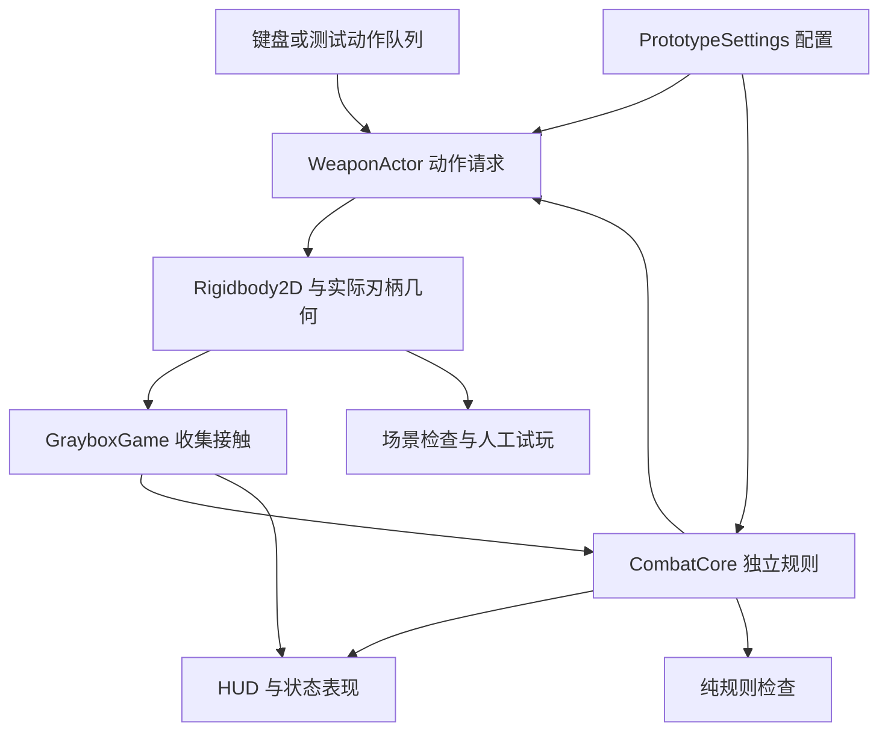

# 开发指南与协作协议

更新：2026-11-22（Asia/Shanghai）。本文件是工程接手入口。玩法权威为 [GDD](GDD_MVP.md)，最新试玩修订见 [问题清单](Graybox_Issues.md)，决定历史见 [项目记忆](Project_Memory.md)。当前归档没有实施那四项待修问题。

## 1. 环境与恢复

公开仓库：[diodazi/weapon-rogue-graybox](https://github.com/diodazi/weapon-rogue-graybox)，主分支 `main`。在目标工作目录执行后，按下表恢复工程：

```powershell
git clone https://github.com/diodazi/weapon-rogue-graybox.git
```

| 项目 | 版本／入口 |
|---|---|
| Unity Editor | `6000.6.5f1`，以 `WeaponGraybox/ProjectSettings/ProjectVersion.txt` 为准 |
| Unity 工程根目录 | 仓库内 `WeaponGraybox/`；不要将仓库根目录作为 Unity 工程打开 |
| 渲染 | URP 2D，`com.unity.render-pipelines.universal` 17.6.0 |
| 输入 | Input System 1.20.0；当前键盘单人 |
| UI | uGUI / TextMeshPro，`com.unity.ugui` 2.6.0 |
| 自动化连接 | Unity Pipeline 0.8.0-exp.1；本机 CLI 不是运行游戏的必要条件 |
| 规则检查 | .NET SDK 10，`Tools/RuleChecks/RuleChecks.csproj`，不依赖 NuGet 外部包 |
| Windows 构建 | Unity 同版本 Windows Build Support；当前使用开发构建 |

克隆后打开 Unity 工程，等待依赖和资源导入，再打开 `Assets/Graybox/Scenes/CombatGraybox.unity`。保留 `Packages/manifest.json` 和 `packages-lock.json`。首次恢复需要 Unity 包源访问及本机有效 Editor 许可；不提交许可文件。中文采用本机字体动态加载，优先 Microsoft YaHei、SimHei，兼容性见历史报告。

## 2. 工程结构与职责

| 路径／文件 | 职责 | 改动注意 |
|---|---|---|
| `Assets/Graybox/Runtime/CombatCore.cs` | 不依赖 Unity 的命中、架势、保护、冲刺资源与交锋结算 | 保持可独立测试；效果来源分别移除；同组交锋先快照再提交 |
| `Assets/Graybox/Runtime/WeaponActor.cs` | Rigidbody2D、刃柄触发器、动作与输入队列、Boss 决策 | 受控力／力矩驱动；当前圆形支撑体和共用摆动是灰盒实现 |
| `Assets/Graybox/Runtime/GrayboxGame.cs` | 选角／大厅／战斗／结果、实际接触收集、结算与键位 | 输入、接触、规则、表现避免互相吞事件 |
| `Assets/Graybox/Runtime/GrayboxSettings.cs` | 调试配置的类型与默认值 | 只改源码默认值不会更新已有 `.asset` |
| `Assets/Graybox/Settings/PrototypeSettings.asset` | 场景实际引用的参数实例 | 通过 Unity Inspector／Editor API 修改，修改后导出快照 |
| `Assets/Graybox/Runtime/GrayboxHud.cs` | 中文状态框、选角、确认与结果 UI | 显示固定术语及真实状态，不把临时值当正式平衡 |
| `Assets/Graybox/Runtime/GrayboxShapes.cs` | 几何占位、轮廓与材质 | 正式手绘参考到位后替换，不改变规则含义 |
| `Assets/Graybox/Runtime/GrayboxPlayProbe.cs` | 开发模式下的场景回归 | 动作队列注入＋真实物理；不是实体键盘或人工手感验收 |
| `Assets/Graybox/Runtime/GrayboxParryProbe.cs` | 编辑器中的多时机轨迹诊断 | 轨迹文件用于定位，不是胜率统计 |
| `Assets/Graybox/Editor/GrayboxBuilder.cs` | 创建／打开测试场景及 Windows 构建 | 通过 Editor 生成场景与资源；保留 `.meta` GUID |
| `Tools/RuleChecks/` | 纯规则行为检查 | 直接链接工程内 CombatCore，避免复制出第二套规则 |
| `Tools/ActionSkills/` | 项目内动作方法与许可证 | 参考工具副本，项目运行不需要安装 AI 技能 |
| `Evidence/` | 历史配置快照、测试 JSON、轨迹、截图 | 不把旧证据当新版本验证；原始机器日志不提交 |



## 3. 必须保留的实现不变量

| 类别 | 不变量 |
|---|---|
| 固定术语与按键 | 移动 A/D、蓄力 S、轻攻击 J、跳跃 K、冲刺 L、重攻击 U；W 不跳跃 |
| 刃／柄 | 柄受击 HP 倍率更高；分区不改变普通命中的架势量；柄攻击只在专门招式中启用 |
| 弹反 | 有效动作窗口与真实刃接触同时满足；精确弹反需要预判输入和接触对齐 |
| 弹反保护 | 只免 HP；不自动免命中架势、击退或打断；短于恢复 |
| 破势 | 固定失控时间，受击不续时；结束恢复操作、架势归零后继续锁定一段时间 |
| 霸体 | 仍受 HP 伤害；锁架势，免打断／击退／破势；其攻击不能弹反 |
| 蓄力冲刺 | 满蓄力并保持 S 后按 L；只有残影中段提供四项命中保护；最新需求另增加单位穿身，当前待修 |
| 冲刺资源 | 普通／蓄力共享 2 次；有效发动与扣除原子提交，回充不重复；1.5 秒暂定 |
| 多方交锋 | 逐对判定；失败者正常受击；同一攻击方弹反架势只算一次；新保护不能回溯吞掉失败命中 |
| 大厅 | 无限 HP；最右区域到位并逐人确认后开始；当前只实现单人 |
| 数值 | 已确认常量、暂定值、PROTOTYPE_ONLY 和 OPEN 分开；未知值 `null` 不等于零 |

最新局部弹反停顿和回弹尚未实现。其后续实现要独立于 HP 保护计时，保证第三方继续行动，不能用冻结全局时间替代局部停顿。

## 4. 开发闭环与岗位交接

| 阶段 | 进入与产出 |
|---|---|
| Loop A | 新问题未闭环时，每轮仅问 1–3 个核心问题；未闭环不提前写完整新机制文档 |
| Loop B | 用户确认闭环或要求开始策划后，聊天提交 Pitch、核心循环、3C、数值、MVP 范围和至少两个极端漏洞防范大纲 |
| Loop C | 用户要求归档后静默写入 `Docs/GDD_MVP.md`；包含 Mermaid、结构化数据与末尾边缘测试 |
| 实施 | 按既有及最新授权推进；先读 GDD／项目记忆，变更写入明确的负责文件，实际状态与参数分离 |
| 验收 | 复现场景→实现→针对性回归→实际运行→用户试玩；没有结果证据不标为已修复 |

本次用户明确要求将现有项目上传 GitHub 并附开发文档，因此归档已确认反馈和现有架构；尚未确认的参数继续保留待定。岗位与技能具体职责见 [Team_Staffing.md](Team_Staffing.md)。执行中可用当前会话的临时协作岗位，不能把岗位表当作常驻员工进程。

## 5. 测试、配置与构建

### 5.1 规则检查

在仓库根目录：

```powershell
dotnet run --project Tools/RuleChecks/RuleChecks.csproj -- WeaponGraybox/Evidence/rule-results.json
```

`NuGet.Config` 清空外部包源；测试只需要安装 .NET SDK 10。检查 HP 保护与残影区别、资源幂等、固定破势、架势锁定、同组交锋置换等。返回码非零表示失败。

### 5.2 实际场景检查

在编辑器 Play 模式下，通过 Unity Editor API 将 `WeaponGraybox.Editor.GrayboxPlayProbe` 添加到 `GrayboxGame` 对象执行；此处命名空间虽含 Editor，类型位于 Runtime 并按开发条件编译。探针结束返回选角并自行移除，写入 `Evidence/playmode-results.json`。

测试包含初始状态设置、动作队列注入与真实物理。胜负测试通过脚本建立死亡条件，不是完整自然对战。当前探针没有覆盖 [Graybox_Issues.md](Graybox_Issues.md) 中的新验收线，因此旧通过结果不能关闭它们。

### 5.3 Windows 构建与独立程序

编辑器退出 Play 后运行菜单 **Graybox > Build Windows Test**，或在 Unity Editor API 中调用 `WeaponGraybox.Editor.GrayboxBuilder.BuildWindows()`。该方法生成开发包与 `Evidence/build-result.json`。

在 Unity 工程目录运行开发包的可选自测：

```powershell
Set-Location WeaponGraybox
& './Builds/Windows/WeaponGraybox.exe' --graybox-self-test
```

程序完成场景探针后退出，写入 `Evidence/standalone-results.json`，并尝试保存选角／战斗截图。保留整个构建目录；首次克隆没有 `.exe`，需先构建。正常试玩不加自测参数。

### 5.4 证据的时间与适用范围

| 记录 | 日期 | 范围 |
|---|---|---|
| `rule-results.json`、`playmode-results.json`、`standalone-results.json` 与截图 | 历史首轮：2026-10-18 | 28 项纯规则、25 项场景、25 项独立运行；依旧不代表本轮反馈已修复 |
| `settings-snapshot.json` | 历史首轮：2026-10-18 | 当时实际配置，不是最终平衡 |
| `verification-manifest.json` | 历史首轮：2026-10-18 | 旧构建程序集哈希；构建输出被忽略，克隆后无法直接对照该二进制 |
| `rule-upload-check.json` | 上传前复跑，以 JSON 中记录日期为准 | 仅针对当前规则源码，不能扩展为 Unity 再验收 |

原始编辑器／玩家日志含本机路径，保留本地排查，仓库提交精选 JSON、截图和轨迹。修改数值资产后重新导出快照，并记录提交、环境、测试范围及未覆盖项。

## 6. GitHub 与提交规范

- 提交 `Assets/` 和配套 `.meta`、`Packages/`、`ProjectSettings/`、源码、文档及必要证据。
- 忽略 `Library/`、`Temp/`、`Logs/`、`Builds/`、`UserSettings/`、IDE 缓存、.NET 缓存及本机工具。不要强制添加这些目录。
- 移动资产时保留 `.meta`；避免手工编辑场景或资源 YAML。修改场景、资产和项目设置时使用 Unity Editor／API。
- 当前单个待提交文件不足 GitHub 常规单文件限制，不引入 Git LFS。后续大型源图／音频出现时再明确 LFS 范围。
- 仓库默认分支为 `main`；提交说明描述实际行为、为什么改、验证范围。禁止将 TODO 修订写成已经完成的功能。
- 现有仓库接入先检查远端历史；不覆盖别人的提交，不使用强制推送。
- 项目整体许可证尚待指定；第三方声明与原许可证保留，见 [THIRD_PARTY_NOTICES.md](../THIRD_PARTY_NOTICES.md)。

## 7. 边缘测试／漏洞预判

| 风险 | 验证要求 |
|---|---|
| 缓存或本机路径掩盖克隆缺文件 | 从 Git 跟踪内容核查场景、设置、资源、包清单、`.meta` 与文档链接；Unity 恢复需另做实机检查 |
| 只改默认值，已有资产仍用旧值 | 通过 Editor 修改实际配置，读回资产并导出 JSON |
| 停顿冻结保护、冲刺退出残留无敌 | 分开计时与状态来源，验证第三方和所有退出路径 |
| 无敌穿身退出时重叠 | 不靠延长无敌掩盖；测试墙边、空中、取消与房间切换 |
| 旧自动检查掩盖玩家体验问题 | 保留用户缺陷清单，新增真正覆盖失败场景的回归，再由试玩确认 |
