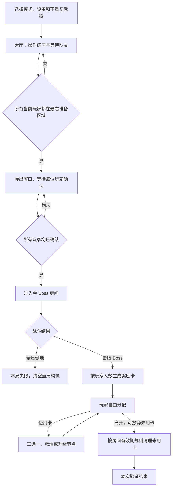
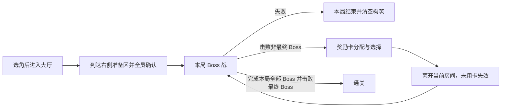
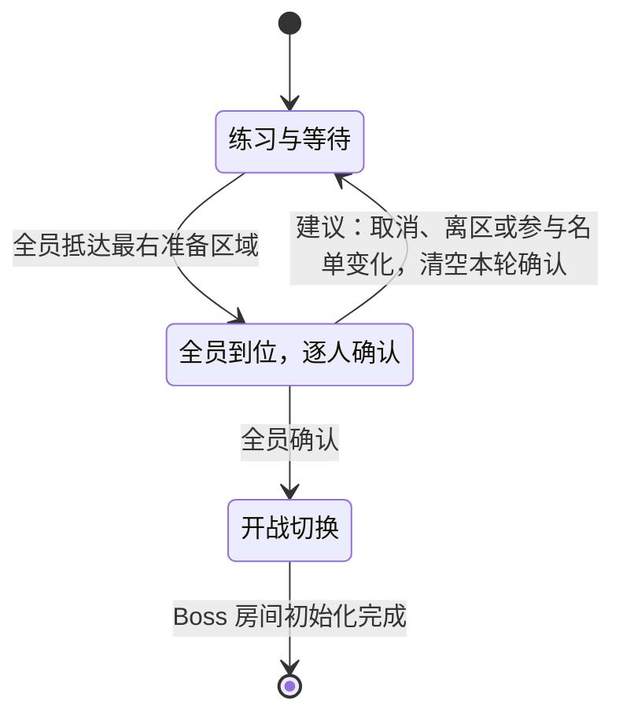
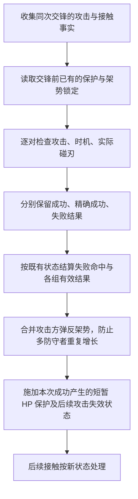
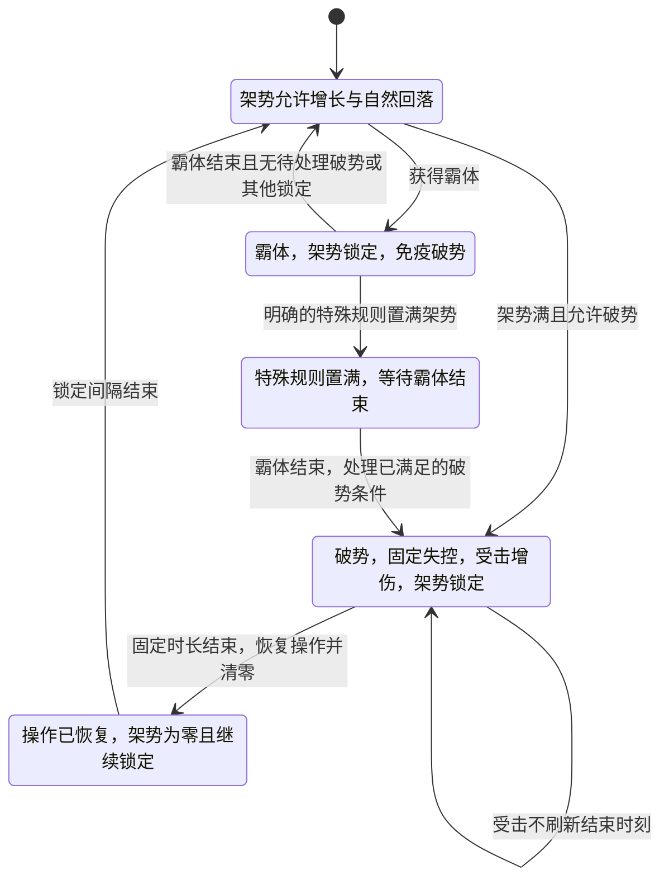
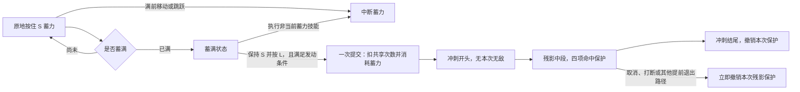
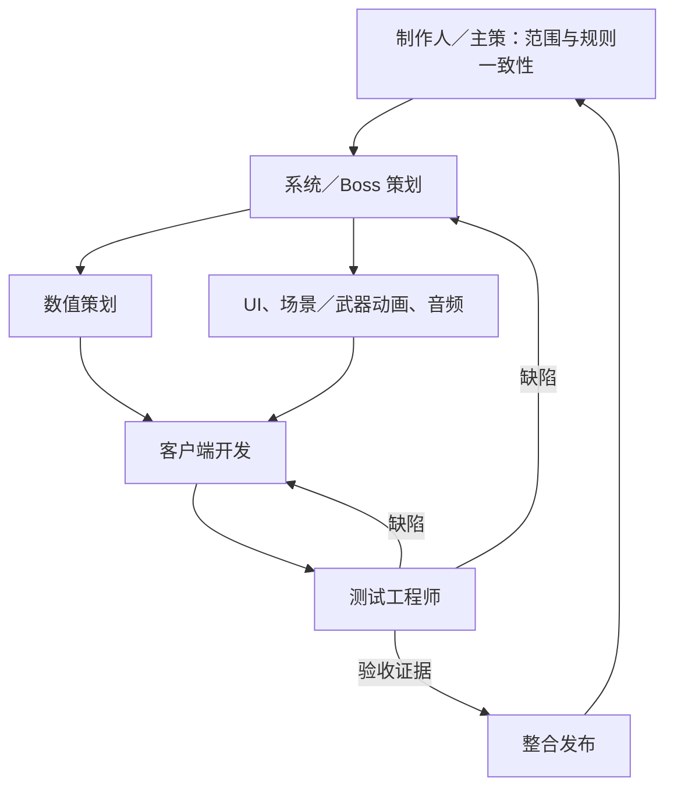

# MVP GDD｜手绘武器 Boss 战斗验证版

> 文档版本：0.4｜首次整理：2026-10-15｜本次更新：2026-11-22（Asia/Shanghai，归档试玩修订与开发交接）  
> 项目名称：待定；工程目录名称不视为正式游戏名。  
> 当前阶段：战斗机制基线已归档；用户已授权先开展几何占位灰盒工程与机制测试。正式手绘造型、动画及依图稿制作的模组仍等待参考。  
> 当前首轮范围：键盘单人，刀／剑／矛可选，大厅及最右准备区确认，一个测试 Boss；完整 1–3 人本地同屏目标保留，手柄与多人适配后续迭代。  
> 配套文档：[开发指南](Development_Guide.md)、[灰盒问题](Graybox_Issues.md)、[项目记忆](Project_Memory.md)、[岗位分工](Team_Staffing.md)。
> 最新状态：四项灰盒问题已确认但尚未修改；以下设计目标不代表当前源码已实现。2026-10-18 历史自动检查不能覆盖这些新验收线。

## 0. 阅读约定与执行协议

### 0.1 需求状态

| 状态 | 含义 | 后续使用规则 |
|---|---|---|
| CONFIRMED／已确认 | 用户明确提出或选择的需求 | 作为设计基线；修改时登记变更 |
| PROVISIONAL／暂定 | 已允许作为初始调试值，但尚未经过验证 | 可以调优，不冒充最终平衡值；当前冲刺回充间隔为 1.5 秒暂定 |
| PROTOTYPE_ONLY／仅限原型 | 为灰盒运行或对比测试设置的临时参数，不是用户确认的设计值 | 显式标注、单独记录用途与适用范围；不能覆盖已确认规则，也不能因进入工程自动升级为 CONFIRMED |
| DERIVED／直接推论 | 由已确认规则直接得到的结果 | 必须注明依据，不冒充用户原话 |
| PROPOSED／建议 | 制作人或审查人员提出、用户尚未单独确认 | 可用于讨论和验证设计，不视为已批准机制 |
| OPEN／待定 | 尚无决定或缺少资源 | 使用明确占位符，不自行补写成事实 |
| DEFERRED／后置 | 已明确不在当前制作阶段实施 | 不进入当前开发任务 |
| SUPERSEDED／已替换 | 曾讨论过但已被后续决定替换 | 仅保留追溯，禁止用于当前实现 |

本文件是已审定机制与待完善项组成的设计基线，不是已经实现、测试通过或完成平衡的游戏说明书。`null` 表示尚未确定，不能解释为零，也不能作为可运行配置的默认值。未知参数可在单独的灰盒配置中使用明确标为 `PROTOTYPE_ONLY` 的临时值，设计基线仍保留 OPEN，直至形成后续决定。“已审定实现约束”表示用户已认可的实现方向，不代表已有代码或运行证据。

### 0.2 用户指定的三个设计闭环

| 阶段 | 触发条件 | 工作与输出 |
|---|---|---|
| Loop A：需求对齐 | 新想法或核心机制尚未闭环 | 每轮只问 1–3 个核心机制／表现问题；核心未闭环前不写文档 |
| Loop B：机制蓝图 | 用户确认需求闭环，或要求开始写策划案 | 先思考两个最容易崩盘的极端情况；聊天中提交含 Pitch、核心循环、3C、数值框架、MVP 范围、漏洞防范的大纲供审阅 |
| Loop C：文件归档 | 用户要求整理完整文件并存入工程 | 检查／创建 `Docs/`，完整 Markdown 写入并覆盖保存 `Docs/GDD_MVP.md`；包含 Mermaid 与结构化数据；聊天仅汇报结果 |

- 归档与后续迭代前，先读取 `Docs/GDD_MVP.md` 与 `Docs/Project_Memory.md`；首次整理不存在旧文件时，明确按首次创建处理。
- 大纲通过本身不自动授权实际游戏开发；用户此后已单独授权先做灰盒测试。几何占位工程与机制验证无需等待手绘图，正式造型、动画及依图稿制作的模组仍受参考图前置约束。
- 逻辑与数值、表现资源分离。机制必须写成状态、条件、事件或规则；不以主观形容词代替验收标准。
- 聚焦当前验证范围，不主动扩展大世界、复杂匹配、跨平台网络服务或完整内容库。
- v0.2 按用户“进入loop c”的指令归档战斗基线；v0.3 根据用户“手绘参考暂不进入，先进行灰盒测试”的新授权调整开发前置与首轮范围。文档更新不等于工程、运行测试或发行包已经完成。

## 1. 一句话 Pitch 与产品目标

玩家直接操控儿童涂鸦撕纸风格的刀、剑或矛，通过受控物理攻击与多按键连招挑战由不同武器构成的 Boss；在单人或多人合作中，将随机获得的技能升级与新效果接入有前置关系的技能树，并体验队友互伤带来的互动。

| 产品目标 | 可观察的验证方向 | 状态 |
|---|---|---|
| Boss 战是内容重点 | 招式预警、攻击范围、应对方式、恢复窗口可以分别描述和测试 | 重点已确认；先用一个几何占位测试 Boss 验证机制，正式形象与依图稿制作的招式模组待参考 |
| 每局形成不同构筑 | 奖励候选影响节点获得与升级，形成不同效果组合和分支路径 | 已确认；节点库与随机算法待定 |
| 多人互伤产生互动 | 队友攻击可以造成伤害和短暂击退，同时有连续控制保护 | 已确认 |
| 面向不同体验偏好 | 高难度模式与派对模式使用预先设计的不同血量配置 | 已确认；具体数值待定 |
| 视觉统一 | 纸张背景、手绘线条、撕边拼贴武器／道具、波普艺术元素 | 已确认 |

## 2. 已确认需求清单

| ID | 需求 | 约束／补充 |
|---|---|---|
| CORE-01 | Unity 开发的 2D 横板动作游戏 | Unity 版本、渲染管线尚未指定 |
| CORE-02 | 玩家控制武器本体 | 不默认存在持武器的人形角色 |
| CORE-03 | 可选刀、剑、矛 | 多人不能选择重复武器 |
| CORE-04 | 地面横板动作，具有多按键连招与派生攻击 | 基础键位已确认；具体招式、衔接与取消窗口待调试 |
| CORE-05 | 基础攻击采用受控物理 | 按键施加力／力矩，限制速度与偏转；伤害主要由招式和天赋决定 |
| MODE-01 | 高难度与派对两种模式 | 必须有不同血量配置；具体作用对象和数值待定 |
| MULTI-01 | 完整验证版保留 1–3 人本地同屏目标 | 首轮灰盒先键盘单人；手柄与多人适配在后续迭代，在线联机后置 |
| INPUT-01 | PC 端，单人支持键鼠或手柄 | PC 的具体操作系统支持范围未确认 |
| INPUT-02 | 多人支持一套键鼠加手柄，或全手柄 | 没有确认多人共享同一键盘 |
| INPUT-03 | 先开发键盘操作，后完善手柄适配 | A/D 移动、S 蓄力、J 轻攻击、K 跳跃、L 冲刺、U 重攻击；W 不跳跃 |
| COMBAT-01 | 队友互伤 | 扣血并短暂击退，有连续控制保护；完整适用弹反、架势与破势规则 |
| COMBAT-02 | 武器分为刃、柄两个受击区域 | 柄额外受伤、刃减伤；区域差异只影响 HP 伤害 |
| COMBAT-03 | 弹反与精确弹反均要求实际碰刃 | 有效攻击与窗口成立；精确弹反要求预判输入及对应精确接触时机 |
| COMBAT-04 | 普通命中微量增加架势，弹反分别增加双方架势 | 先攻方高于成功防守方，精确弹反额外增加先攻方架势 |
| COMBAT-05 | 破势固定失控时长，受击增伤，架势锁定 | 受击不延长；结束恢复操作、清零但继续锁定，延迟后解锁 |
| COMBAT-06 | 霸体攻击不可被弹反，免疫打断、击退、破势 | 仍扣 HP；架势锁定；特殊规则产生的满架势在霸体结束后处理 |
| COMBAT-07 | 初始蓄力技能只有蓄力冲刺 | 必须蓄满，保持 S 时按 L；中段残影有完整命中保护，开头和结尾无该保护 |
| COMBAT-08 | 普通与蓄力冲刺共用两次使用机会 | 上限 2，每次恢复 1；回充间隔 1.5 秒暂定 |
| COMBAT-09 | 多方碰刃逐对判断，每个先攻方的架势不因多个成功防守者重复增长 | 同次交锋先收集结果，再结算并施加新弹反保护；具体分组与混合增量待定 |
| DEATH-01 | 倒地后可由队友冒险救起 | 救援时间、距离、消耗、中断与次数待定 |
| DEATH-02 | 全员倒地则本局结束 | 清空当局成长与技能树；天赋点已取消，不再建立点数清零系统 |
| REWARD-01 | 击败 Boss 后掉落奖励 | 单人一张；多人按玩家人数掉落对应数量；人数取样时点待定 |
| REWARD-02 | 奖励有两类 | 已有技能升级、新效果；类别随机 |
| REWARD-03 | 使用奖励卡后三选一 | 候选内容与生成细则待定 |
| REWARD-04 | 卡直接激活或升级树节点 | 取消天赋点；新效果保留分支前置要求 |
| REWARD-05 | 多人自行分配卡牌 | 可以全部集中给同一名玩家 |
| REWARD-06 | 卡必须在当前房间使用才有效 | 离开当前房间进入下一关后，未用卡失效；允许放弃未用卡离开 |
| LOBBY-01 | 选定角色后先进入大厅 | Demo 与正式游戏均适用 |
| LOBBY-02 | 大厅用于练习与等待队友 | Demo 为本地加入；未来在线阶段承接在线队友等待 |
| LOBBY-03 | 大厅友伤默认开启，所有玩家无限血量 | 大厅内不能死亡；不等于已确认霸体或取消击退 |
| LOBBY-04 | 准备区域位于大厅最右侧 | 灰盒可用临时几何区域验证确认流程；正式尺寸与视觉表现待完善 |
| LOBBY-05 | 全员到区域后弹窗，全员确认后开战 | 多人逐人确认；单人到区域后自行确认即可；无发起者额外开始步骤 |
| FLOW-01 | 正式完整一局通过全部 Boss，最终击败最终 Boss 后通关 | Boss 总数、路线和顺序尚未确定 |
| SCOPE-01 | 当前先做一个 Boss 的战斗验证 | 不把它当作完整连战版本 |
| ART-01 | 手绘、儿童涂鸦、纸张拼贴，带波普艺术效果 | 不使用像素风作为项目默认画风 |
| GATE-01 | 允许先做几何占位灰盒工程与机制测试 | 正式手绘造型、动画及依图稿制作的动作／战斗模组仍等待参考；不以占位资源定稿美术 |
| SCOPE-02 | 首轮灰盒为键盘单人、三武器可选、大厅准备确认及一个测试 Boss | 后续再适配手柄与 1–3 人本地同屏；不永久取消原有产品需求 |
| REV-01 | 修正从背后攻击的碰撞可达性 | 实体阻挡与真实刃／柄接触匹配；三武器、前后、左右及大厅／战斗对照，具体形状待复现调试 |
| REV-02 | 基础跳跃能躲过贴地、低位横扫 | 通过空间避让；能否跳过本体取决于目标体型；高度与轨迹仍待调参 |
| REV-03 | 蓄力冲刺残影中段能穿过单位 | 原四项命中保护保留；地面／墙体与结束重叠处理是待验证工程细节 |
| REV-04 | 成功弹反有回弹、反震与局部碰撞停顿 | 攻击方明显回弹，防守方短促反震后稳定；只停顿双方，第三方继续运行；时长和幅度待定 |
| REV-05 | 后续优化不同武器动作模组 | 刀／剑／矛分别完善轨迹、节奏、派生和回收；正式依图稿制作仍等待参考 |

## 3. 范围与开发前置条件

### 3.1 当前首轮灰盒与后续验证范围

| 范围项 | 当前定位 |
|---|---|
| Boss 内容 | 首轮一个几何占位测试 Boss，用于已确认战斗机制的验证；不据此确定正式 Boss 武器构成、外形或最终招式库 |
| 大厅 | 首轮保留选角后的大厅、操作练习、无限血量、最右准备区域与单人自行确认；完整多人版继续采用全员到区、每人确认的规则 |
| 玩家武器 | 首轮刀／剑／矛三种均可选择，以几何占位表现；正式造型、动画与武器差异仍待完善 |
| 输入与多人 | 首轮键盘单人；完整 1–3 人本地同屏、不重复选角与混合输入设备目标保留，手柄及多人适配安排在后续迭代 |
| 模式 | 验证高难度与派对模式的配置切换；血量尚无批准数值 |
| 成长 | 验证掉卡、分配、三选一、前置校验与效果生效，不先制作完整连战经济 |
| 美术 | 灰盒可使用几何占位形体、轮廓与反馈；正式手绘造型、动画及依图稿制作的模组等待参考，不把占位资产认作最终风格 |

### 3.2 不在本阶段实施

- 第二个及后续 Boss、最终 Boss 的完整内容制作、完整连战长度。
- 在线房间服务、公网匹配、账号、服务器运营、跨平台联机、复杂断线重连。
- 大世界、探索地图、支线关卡或额外职业。
- 尚未确认的跨局永久成长、商店、货币、装备掉落、付费或商业化系统。
- 首轮不交付手柄与多人适配；这两项是后续迭代目标，不是永久取消。
- 在参考图到位前自行定稿正式手绘造型、动画及依图稿制作的模组；几何占位工程、临时动作和机制测试已获授权。

“刀枪剑戟”出现在美术描述中，表示武器题材，不自动扩展当前三个可选玩家角色。

### 3.3 建议的验证顺序（PROPOSED）

1. 首轮灰盒：用几何占位建立三武器选择、键盘单人操作、大厅及最右准备区确认。
2. 单 Boss 机制验证：在一个测试 Boss 上验证物理接触、弹反、架势、破势、蓄力与共享冲刺等已确认规则；未知参数使用单独标记的临时值。
3. 后续输入与多人适配：接入手柄及 1–3 人本地同屏，验证设备归属、不重复选角、友伤、救援和多人确认；不能用单人结果代替这些验收。
4. 奖励及成长：按既有规则验证掉卡和构筑，使用真实领奖得到的构筑快照重打同一 Boss，比较基础与成长后的行为。
5. 图稿到位后：拆解纸片层级、支点、可动部位与碰撞轮廓，替换正式造型和动画，并复验受影响的机制。
6. 测试发行包：按实际完成范围汇总缺陷、配置版本、资源版本与实机构建证据。

以上是建议的工作顺序，不是完成记录；首轮范围与灰盒授权以 3.1 节为准。重打同一 Boss 的构筑比较属于隔离测试，不默认为正式游戏的无限重复领奖流程。

### 3.4 灰盒临时配置与验收边界

- 灰盒允许为未知数值、几何尺寸和窗口设置试验值，但每项必须标记 `PROTOTYPE_ONLY`，记录参数 ID、值、单位、用途与适用范围。若运行必须选择尚未定案的分支，也应单列临时实验假设，不改写确认基线。
- 已确认机制与常量继续生效；例如普通冲刺无保护、残影中段四项保护、共享两次机会，不能以“灰盒”为由省略后仍声称实现了同一规则。未覆盖的机制明确标为未实现或未验证。
- 用户暂定的 1.5 秒回充保持 `PROVISIONAL`。对比试验使用其他值时另记 `PROTOTYPE_ONLY`，不能覆盖它的状态或宣称取得最终平衡结论。
- 首轮键盘单人测试不构成手柄、多人友伤、救援或多方交锋的完整验收；后续适配与测试义务保留。工程是否建成、测试是否通过只按实际证据登记。

## 4. 核心流程

### 4.1 单 Boss 验证版流程

下图保留完整验证版流程。首轮灰盒按其中的单人路径执行：选择刀／剑／矛之一，进入大厅，到最右准备区并自行确认后挑战测试 Boss；多人等待和逐人确认随多人适配接入，不改变原规则。



说明：单 Boss 验证的结束界面、奖励演示后如何退出尚待 UI 设计；图中不代表已确定返回大厅或重新选角。Boss 与全员倒地同一结算时刻发生时的优先级也待定。

### 4.2 完整游戏目标（数量与路线待定）



图中的循环不等于无限模式，也不确定 Boss 随机排列、分支路线或固定顺序。最终 Boss 后是否还展示奖励，尚未确认。

## 5. 大厅与开战规则

### 5.1 已确认状态与条件

| 字段 | 值／条件 | 状态 |
|---|---|---|
| `entry_after_character_selection` | `true` | CONFIRMED |
| `friendly_fire_default` | `true` | CONFIRMED |
| `cannot_die` | `true` | CONFIRMED |
| `ready_zone_location` | `room_rightmost` | CONFIRMED |
| `show_confirmation_when` | 所有当前参与玩家均抵达准备区域 | CONFIRMED |
| `start_when` | 每位玩家在本轮弹窗中确认 | CONFIRMED |
| `extra_host_start_required` | `false` | CONFIRMED；替换旧规则 |
| `single_player_behavior` | 到准备区域→弹窗→自己确认→开始 | CONFIRMED |

大厅内仍有友伤命中互动；大厅免死不能自行解释为“不能被击退”。大厅内是否提供友伤开关、练习木桩或招式教学面板，用户尚未要求。

### 5.2 建议的大厅状态机（包含尚待确认的异常分支）



### 5.3 切换与异常防护建议（PROPOSED）

- 大厅免死采用明确的状态策略，避免把无限浮点值写入普通战斗生命计算。具体数据结构由客户端设计。
- 大厅出界后回到安全点并清除失控速度，不通过死亡／救援流程恢复。
- 每位玩家的确认只接受其绑定设备输入；一台设备不能代替其他玩家确认。
- 任一玩家取消、离开准备区域，或队伍成员变化时，清空本轮确认。该规则目前是建议，未单独获用户确认。
- 开战切换只允许触发一次；锁定本轮参与玩家、武器和模式，避免重复加载。
- 进入 Boss 战时显式恢复有限血量规则，清理大厅残留攻击物和临时控制状态；保留应继承的角色数据，不误清技能构筑。
- 大厅练习不产生奖励卡或可带入 Boss 战的额外成长收益。冷却、能量等是否重置，待这些资源是否存在及具体规则确定后再定义。

## 6. 3C 与战斗机制蓝图

本章是本次 Loop B 已审定的战斗基线；具体数值、动画与碰撞轮廓仍按状态标记完善。文中“攻击方／防守方”是某次攻击关系中的角色，同一单位在不同关系中可以承担不同角色。

### 6.1 固定称呼、3C 与键位

固定称呼：**移动、蓄力、轻攻击、跳跃、冲刺、重攻击、刃、柄、弹反、精确弹反、架势条、破势、霸体、连招、派生攻击、蓄力冲刺**。界面、数据说明与后续文档使用这些称呼；“精确弹反”不另设名为“完美弹反”的独立机制。

| 维度 | 已确认 | 待设计／建议 |
|---|---|---|
| Character | 玩家是刀、剑、矛本体；多人武器不重复；具有刃、柄分区 | 灰盒先用临时几何尺寸、支点与轮廓；正式纸片分层、造型及依图稿模组等待参考 |
| Control | 地面横板，使用下表键位；支持连招、派生、指定窗口取消 | 输入缓冲、同时输入优先级、具体招式与窗口待调试 |
| Camera | 多人同屏 | 建议单 Boss 验证先使用稳定主视野；固定／跟随／缩放、出屏处理待定 |

| 按键 | 固定操作称呼 | 规则 |
|---|---|---|
| A / D | 移动 | 向左／向右移动 |
| W | 待定 | 明确不负责跳跃；不自行赋予抬头、格挡等动作 |
| S | 蓄力 | 按住进行蓄力；用于强化已开放的对应操作 |
| J | 轻攻击 | 基础轻攻击及满足条件的派生 |
| K | 跳跃 | 足以躲过贴地、低位横扫；能否越过本体由体型决定；高度、轨迹与空中控制待调试 |
| L | 冲刺 | 根据蓄力及可用次数执行相应冲刺 |
| U | 重攻击 | 基础重攻击及满足条件的派生 |

实施顺序为键盘优先、手柄随后适配。原有键鼠／手柄的产品设备目标保留；鼠标具体功能与手柄映射未定义。未确认额外独立格挡键或独立弹反键。

### 6.2 受控物理、接触与刃柄分区

| 层 | 责任 | 状态 |
|---|---|---|
| 输入与动作 | 识别基础输入、组合输入、派生与取消窗口 | 机制 CONFIRMED；具体窗口 OPEN |
| 物理运动 | 施加力／力矩，限制速度与偏转 | CONFIRMED；限值 OPEN |
| 接触判定 | 区分进攻部位、受击部位与实际碰刃 | CONFIRMED；形状与具体算法 OPEN |
| 结算 | 分别处理 HP、架势、击退、打断、破势，不共用一个含混的“无敌”开关 | 已审定实现约束 |
| 视觉表现 | 灰盒用几何占位验证运动、预警与接触；正式纸片表现依手绘图稿制作 | 灰盒已授权；正式资源等待提供 |

伤害主要由招式和技能效果决定。没有确认“挥动越快伤害越高”的独立倍率体系，也没有确认完全自由刚体的失衡／缠绕玩法。

| 分区／情况 | HP 规则 | 架势规则 | 轮廓或启用条件 |
|---|---|---|---|
| 受击区域：刃 | 相对基准伤害降低 | 不因刃区域改变同一普通命中的架势增量 | 刀、剑通常占比更大；按图稿定义 |
| 受击区域：柄 | 相对基准受到额外伤害 | 不因柄区域改变同一普通命中的架势增量 | 枪、矛、长柄刀等长杆兵器通常占比更大 |
| 进攻部位：刃 | 大多数攻击使用 | 按该招式结算 | 在对应攻击判定条件下启用 |
| 进攻部位：柄 | 仅专门设计的柄端攻击启用伤害判定 | 对应招式的架势数据待配 | 不因为柄可受击就让柄始终产生攻击伤害 |

同一攻击同时触及同一目标的刃与柄时，采用哪个受击区域、怎样避免双算，仍待设计；不能自动累计两份伤害。静止接触的完整规则也未定，不能把每次物理接触回调直接当作攻击。

### 6.3 连招、派生攻击与主动取消

| 概念 | 成立条件 | 结果／边界 |
|---|---|---|
| 连招 | 同时按下多个按键，或在有效窗口按指定顺序输入 | 执行不同于基础攻击的招式；具体组合表待定 |
| 派生攻击 | 前一动作后在有效条件下接续攻击，且未被打断 | 进入与前一动作衔接的新攻击 |
| 主动取消 | 当前动作处于配置允许的取消窗口，且满足目标动作的条件 | 可以取消并转入目标动作 |
| 超出取消窗口 | 未处于允许取消的时段 | 不允许主动取消；不等于免疫外部受击打断 |

`轻攻击 → 轻攻击派生1 → 轻攻击派生2 → 轻攻击派生3 → 轻攻击收招` 是派生链示意，不要求三种武器全部固定为同样的段数。取消窗口参考格斗游戏思路，通过后续测试确定位置、长度和允许跳转的动作。

### 6.4 攻击附带的接近位移

| 字段 | 当前规则 | 状态 |
|---|---|---|
| `purpose` | 部分招式的一小段额外位移，压缩与敌方的距离 | CONFIRMED |
| `target_selection` | 选择最近的敌对目标 | CONFIRMED |
| `sampling_time` | 出招开始时采样目标位置，确定方向与距离 | CONFIRMED |
| `track_after_start` | `false`；开始后不持续追踪 | CONFIRMED |
| `auto_target_allies` | `false`；友伤不把队友变成自动接近目标 | DERIVED |
| `search_radius / max_distance / no_target_behavior / tie_break` | `null` | OPEN |

该位移附属于招式，不提升为独立的持续锁定或追踪系统。物理运动仍受速度、偏转和场景碰撞约束；具体墙面处理待定。

### 6.5 弹反、精确弹反与时序

| 判定或效果 | 弹反 | 精确弹反 |
|---|---|---|
| 输入与动作 | 双方进行攻击动作，符合相应有效窗口 | 预判对方动作，在配置的精确输入时机发出攻击 |
| 物理必要条件 | 双方的刃实际相碰 | 同样要求实际碰刃，并符合精确接触时机 |
| 输入与接触关系 | 按招式配置校准 | 输入稍早于接触，输入、运动与接触需要配合 |
| HP | 该成功防守关系内不扣双方 HP | 同左 |
| 攻击效果 | 攻击方本次攻击被弹反失效；多方同次交锋按 6.6 节先结算独立结果 | 同左 |
| 攻击方架势 | 增加，幅度高于成功防守方 | 在普通弹反基础上额外增加 |
| 成功防守方架势 | 增加较少；数值待定 | 对应基础增量待定，不额外推定零消耗 |
| 短暂无敌 | 成功参与双方获得仅针对 HP 伤害的很短保护 | 同左；两类具体时长是否相同未定 |

架势增量服从当前架势锁定状态。原解释中的“1 2 3 4 5 6 7 8 9 0”只是动画阶段示意，不能作为所有招式统一的实际帧数、时长或精确窗口。

- 每个武器、每个动作分别对齐预警、输入、物理接触和精确窗口，使可见时机与成功条件一致。
- 按键正确但未碰刃，不能凭输入直接弹反；输入命中精确窗口也不生成可无限等待的“精确资格”。
- 输入正确但接触晚于适用窗口的具体容错、降级或失败规则，仍待逐招式校准。
- 弹反 HP 保护短于双方各自的弹反恢复窗口；保护结束后，第三方攻击可以在恢复期间正常扣血。
- 弹反 HP 保护不阻止命中带来的架势增长、击退和打断，也不撤销本次弹反本身应结算的架势。

### 6.6 三人及多方碰刃：逐对判定与合并结算

以下是最新修订后的已审定实现方向。成功防守不能让同次交锋内另一组失败防守自动变成成功。

| 关系 | 独立判定 | HP 结果 | 架势结果 |
|---|---|---|---|
| 一攻二守，两名防守方都成功 | 分别检查两组时机与实际碰刃 | 两组成功关系均不扣血 | 攻击方只增加一次；两名成功防守方各自结算 |
| 一攻二守，一成功一失败 | 保留一组成功和一组失败 | 成功关系免伤，失败者按正常受击规则结算 | 攻击方不因多个碰撞重复增加；失败命中微量架势仍服从锁定等规则 |
| 二攻一守，两组均成功 | 分别检查两个来袭攻击 | 两组均按成功处理 | 两个攻击方分别承担自身结果，不能全局合并成一个攻击方 |
| 二攻一守，只成功防住一组 | 保留两组不同结果 | 另一组失败仍按正常受击规则结算 | 不因一次成功吞掉另一组合法结算；防守方多次增量合并规则待定 |
| 同一攻击出现普通与精确两种成功结果 | 保留每组成功等级 | 成功关系不扣血 | 攻击方增长次数仍为一次，具体金额如何取值待定 |

“正常受击规则”包含交锋开始前已经有效的 HP 保护、霸体和架势锁定；不表示失败就绕过所有既有保护强制扣血。



边界约束：

- “同次交锋”的分组键与时间边界仍待定义；不把整个显示帧、整场战斗或所有单位的攻击粗暴合并。
- 先收集结果，防止先处理的一组成功提前打开无敌或删除攻击，从而吞掉同组交锋中本应受伤的失败者。
- 分别保存每一攻击与防守对象的判定结果，同时对同一攻击方的本次弹反架势增长去重；不能只保留第一个接触者。
- 普通／精确混合时的单次增量取值，以及二攻一守时防守方的增量聚合，保留 `null`；不能擅自决定相加或取最大。
- 实际多段攻击的段标识、下一段是否重新构成交锋，以及同时起手时的先攻方识别，均待逐招式规则完善。

### 6.7 架势、破势与霸体

| 状态／事件 | 操作能力 | HP | 架势 |
|---|---|---|---|
| 正常受击 | 按招式及控制保护处理 | 正常伤害规则 | 普通命中仅微量增加；刃柄差异不改变增量 |
| 一段时间没有新增架势压力 | 正常 | 不自动回血 | 允许回落时自然下降；延迟与速率待定 |
| 架势达到上限且允许破势 | 转入破势 | 后续受击伤害增加 | 锁定，不从零开始重新增长 |
| 破势持续中 | 无法操作，只能承受攻击 | 使用破势增伤配置 | 保持锁定；受击不刷新或延长失控时长 |
| 破势结束 | 立即恢复操作 | 不自动获得 HP 无敌 | 清零，但继续锁定 |
| 破势后锁定间隔结束 | 正常操作 | 正常伤害规则 | 重新允许增长与自然回落 |
| 霸体期间 | 不受受击打断或击退；其攻击不可被弹反 | 仍受伤，其他既有 HP 保护独立处理 | 锁定，不因普通压力增长或自然回落，不发生破势 |
| 特殊设计在霸体中置满架势 | 不立即破势 | 同上 | 由明确的 Boss／技能例外记录待破势；霸体结束后再处理 |

霸体锁定是一般规则；不能让普通受击穿透锁定，再称为特殊设计。霸体结束若有已登记的满架势破势条件，则转入破势；没有该条件时也不能自行清空架势。与其他锁定重叠时的计时优先级仍待定。



此图表达已确定的主要路径；破势期间能否新获霸体、破势后锁定与霸体重叠的计时规则不在图中虚构。破势后的架势锁定不是受击打断免疫，也不能替代友伤连续控制保护。

短时霸体可来自特定连招／派生后段；长时霸体可来自 Boss 阶段或满足要求的技能效果。一次性道具仅是未来可能来源，不因此把完整道具、背包或商店系统加入当前 MVP。

### 6.8 保护效果必须分别配置

| 状态 | 免 HP 伤害 | 免命中架势增长 | 免击退 | 免受击打断 | 额外规则 |
|---|---|---|---|---|---|
| 弹反后的短暂保护 | 是 | 否 | 否 | 否 | 短于双方弹反恢复时间；不免除弹反架势结算 |
| 普通冲刺 | 否 | 否 | 否 | 否 | 冲刺本身不提供无敌；其他状态独立判断 |
| 蓄力冲刺开头／结尾 | 否 | 否 | 否 | 否 | 此阶段没有残影保护 |
| 蓄力冲刺残影中段 | 是 | 是 | 是 | 是 | 最新要求：可穿过单位；退出中段立即移除本状态贡献的保护；当前源码待修 |
| 霸体 | 否 | 是，架势整体锁定 | 是 | 是 | 自身攻击不可被弹反，免疫破势，特殊满架势延后处理 |
| 破势后的架势锁定 | 否 | 是，架势锁在零 | 否 | 否 | 恢复操作与解除锁定是两个时刻 |
| 大厅无限血量 | 无法因 HP 死亡 | 不由无限血量推导免疫 | 不由无限血量推导免疫 | 不由无限血量推导免疫 | 仍保留练习与友伤，不等同霸体 |

表内“否”仅表示该状态不提供对应保护，不能覆盖同一单位已生效的其他保护。蓄力残影的免架势增长仅针对命中，不自行冻结自然回落。多种保护应记录各自来源；移除残影时不得清除独立存在的霸体或弹反 HP 保护。

### 6.9 蓄力与共享冲刺次数

| 条件／事件 | 已确认行为 | 尚待明确的边界 |
|---|---|---|
| 按住 S | 原地蓄力，不能边移动边蓄力 | 蓄满耗时；空中是否可开始蓄力 |
| 蓄满前执行移动或跳跃 | 中断本次蓄力 | 其他攻击在未蓄满时的处理 |
| 蓄满后执行当前可用蓄力技能之外的操作 | 清空本次蓄力 | 当前初始阶段，移动、跳跃、轻攻击、重攻击都不属于蓄力技能 |
| 初始可用蓄力技能 | 只有蓄力冲刺 | 后续升级可扩展，当前不补造蓄力攻击 |
| 已蓄满，尚未松开 S，按 L，且可有效发动 | 发动蓄力冲刺，消耗本次蓄力及一次共享冲刺机会 | 无次数、被阻止或无效输入的完整反馈待设计 |
| 未蓄满时按 L | 不得获得蓄力强化效果 | 转为普通冲刺还是拒绝、如何处理半蓄力，待定 |
| 松开 S | 不能再按本次“保持 S 时按 L”的条件释放强化 | 是否立即清空、宽限与重新按住的处理待定 |
| 蓄力冲刺运行 | 开头无本次保护→中段残影保护→结尾无本次保护 | 各段长度、速度与距离待定 |
| 成功冲刺后 | 本次蓄力已消耗 | 仍按着 S 是否自动重新蓄力，待定 |

旧的“蓄力冲刺距离为普通冲刺 1.8 倍”已被无敌冲刺方案替换，**不再是当前效果**。当前未承诺两种冲刺距离相同，也不保留 1.8 倍作为隐含加成。

| 冲刺资源字段 | 值 | 状态 |
|---|---|---|
| `initial_charges` | 2 | CONFIRMED |
| `max_charges` | 2 | CONFIRMED |
| `cost_per_successful_dash` | 1 | CONFIRMED |
| `shared_between_normal_and_charged` | true | CONFIRMED |
| `charges_per_recharge` | 1 | CONFIRMED |
| `recharge_interval_seconds` | 1.5 | PROVISIONAL，用户暂定 |
| `recharge_schedule` | null | OPEN：串行／独立计时、首次起算及重置方式未定 |



图中的提前退出是生命周期清理要求，不新增“残影可被普通命中打断”的规则，也不意味着所有阶段都有主动取消窗口。未满、松 S、无次数等未定分支不通过该图补写默认行为。

**已确认的防复制约束：**

1. 普通／蓄力冲刺读写同一份次数记录，不各自维护两个额度。
2. 有效发动与扣除次数一次完成；成功蓄力冲刺同时消费本次蓄力。
3. 回充事件只生效一次，重复回调不多发次数，不能突破两次上限。
4. 所有退出残影中段的路径立即清除对应保护；取消或切换状态不能复制次数或遗留无敌。

### 6.10 动作定义与逻辑／数据分离

下表是已审定实现方向下的交付结构；字段名是文档接口建议，尚无 Unity 运行时实现。每个动作分别配置，动画、物理驱动与窗口引用同一动作定义。

| 字段组 | 类型／结构 | 语义／单位 | 状态／负责人 |
|---|---|---|---|
| `attack_id / weapon_id` | string | 稳定动作 ID 与武器 ID | 结构建议／系统 |
| `startup / active / recovery` | duration | 秒；不以渲染帧率直接当计时 | 值 OPEN／系统与数值 |
| `offensive_part / hurt_region_refs` | enum / references | 本招刃或专门柄端攻击；受击刃柄轮廓 | 机制 CONFIRMED，引用 OPEN／系统与美术 |
| `drive_force / drive_torque / speed_limits` | numbers | 物理单位需和客户端约定 | OPEN／客户端与数值 |
| `base_hp_damage / hit_posture_gain` | numbers | 基础 HP 与普通命中的微量架势 | OPEN／数值 |
| `parry_windows` | input + contact intervals | 普通／精确输入与接触时段、对齐基准 | 机制 CONFIRMED，值 OPEN／系统与客户端 |
| `combo_transitions / cancel_windows` | arrays | 输入、前置、窗口、目标动作 | 机制 CONFIRMED，具体表 OPEN／系统 |
| `approach` | target policy + movement data | 起手最近敌人快照、附带位移 | 机制 CONFIRMED，幅度 OPEN／系统 |
| `armor_windows` | interval array | 特定阶段的霸体覆盖 | 是否配置及值 OPEN／系统 |
| `segment_id / hit_limit_policy` | identifier / policy | 区分重复接触与设计上的真实多段 | 去重方向已审定，分段规则 OPEN／客户端与系统 |
| `telegraph_ref / impact_feedback_ref` | asset references | 可见预警、接触与恢复反馈 | OPEN／视觉与音频 |
| `counterplay` | condition array | 可弹反时机、躲避路径等应对条件 | OPEN／系统 |

物理回调只提供接触事实，不能独自完成所有伤害和状态提交。多方交锋的收集、判定、去重及提交顺序以 6.6 节为约束；具体 Unity 组件、更新时钟和碰撞检测技术未冻结。

## 7. 友伤、倒地与救援

| 项目 | 已确认规则 | 未确定内容 |
|---|---|---|
| 战斗友伤 | 扣血、短暂击退、连续控制保护；队友间完整适用弹反、精确弹反、架势与破势 | 伤害倍率、击退大小、保护时长、哪些招式可打断 |
| 大厅友伤 | 默认开启，所有玩家无法死亡 | 是否可切换友伤、具体练习反馈 |
| 倒地 | 可由队友冒险救起 | 救援距离、时长、消耗、次数、中断条件 |
| 团灭 | 全员倒地，本局结束并清空当局成长 | 失败后返回位置、结果界面 |
| 单人失败 | 单人倒地时即全员倒地 | DERIVED，依据团灭规则；不新增单人自动复活 |
| 跨局成长 | 未确认 | 不自动建立永久属性、永久天赋或解锁经济 |

友伤连续控制保护仍是独立需求；破势固定时长与破势后架势锁定不能替代它。友伤适用同一套战斗机制，不意味着队友会被攻击附带位移自动选为敌对目标。两种模式是否采用不同友伤倍率或保护参数尚未确认。

## 8. 奖励卡与技能树

### 8.1 奖励规则

| ID | 规则 | 状态 |
|---|---|---|
| REWARD-R01 | Boss 胜利后产生奖励，失败不属于已确认的发奖时机 | CONFIRMED／原始击败 Boss 获得成长的目标 |
| REWARD-R02 | 奖励卡数量对应玩家人数，单人一张 | CONFIRMED；人数快照口径 OPEN |
| REWARD-R03 | 卡类型为已有技能升级或新效果，随机掉落 | CONFIRMED；概率、独立抽取／保底 OPEN |
| REWARD-R04 | 每张卡使用后三选一 | CONFIRMED |
| REWARD-R05 | 已有技能升级作用于已有节点；新效果激活符合前置的节点 | CONFIRMED |
| REWARD-R06 | 不再使用天赋点 | CONFIRMED |
| REWARD-R07 | 多人可集中给同一个人，不设已确认的每人一张限制 | CONFIRMED |
| REWARD-R08 | 未用卡不能跨到下一关使用 | CONFIRMED；允许主动放弃卡牌 |

技能树逐步形成当局构筑。尚未确定树的完整拓扑是否预先编排、节点池大小、根节点数量、每个节点等级上限、互斥分支以及跨武器通用节点。

### 8.2 奖励事务建议（PROPOSED）

| 阶段 | 规则建议 |
|---|---|
| 生成 | 每张卡拥有唯一 `card_id` 和来源 `room_id`；生成数量与本场玩家人数口径一致 |
| 分配 | 未开始有效使用的卡可自由分配；预览、取消与重新分配的详细限制尚待审阅 |
| 候选 | 依据使用者当前构筑校验前置、等级与配置规则；候选应合法且不重复 |
| 锁定 | 生成有效候选后绑定使用者并锁定结果，关闭／重开界面不重新抽取 |
| 提交 | 节点效果写入成功与卡片消耗作为一次事务完成，避免重复奖励或误吞卡 |
| 有效期 | 仅打开选择界面不算使用完成；离房时未提交候选随卡片清理，已获得效果保留 |
| 无合法候选 | 不复制无效项凑满三项，不吞卡；报告内容配置问题；退回分配或允许放弃的兜底细则待审 |

“三选一”的异常兜底尚未确认，不能擅自改为常态二选一、自动换卡或补发天赋点。当前可用节点不足、全部满级等场景必须在测试前显式设计。

## 9. 模式与结构化数值框架

### 9.1 配置占位表

| 字段 | 类型 | 单位 | 值 | 状态／责任 |
|---|---|---|---|---|
| `players.min` | integer | 人 | 1 | CONFIRMED |
| `players.max` | integer | 人 | 3 | CONFIRMED |
| `demo.boss_count` | integer | 个 | 1 | CONFIRMED |
| `full_run.boss_count` | integer/null | 个 | null | OPEN／制作人 |
| `reward.cards_per_player` | integer | 张 | 1 | CONFIRMED |
| `reward.choice_count` | integer | 项 | 3 | CONFIRMED |
| `reward.upgrade_probability` | number/null | 0–1 | null | OPEN／系统与数值 |
| `hard.player_hp` | number/null | HP | null | OPEN／数值 |
| `hard.boss_hp` | number/null | HP | null | OPEN／数值 |
| `party.player_hp` | number/null | HP | null | OPEN／数值 |
| `party.boss_hp` | number/null | HP | null | OPEN／数值 |
| `friendly_damage_multiplier` | number/null | 倍率 | null | OPEN／数值 |
| `friendly_control_guard_seconds` | number/null | 秒 | null | OPEN／系统与数值 |
| `revive_duration_seconds` | number/null | 秒 | null | OPEN／系统与数值 |
| `weapon.max_angular_speed` | number/null | 待约定 | null | OPEN／客户端与数值 |
| `damage.blade_multiplier` | number/null | 倍率 | null | OPEN；相对基准减伤 |
| `damage.hilt_multiplier` | number/null | 倍率 | null | OPEN；相对基准增伤 |
| `damage.broken_multiplier` | number/null | 倍率 | null | OPEN；破势时增伤 |
| `posture.max` | number/null | 架势单位 | null | OPEN |
| `posture.ordinary_hit_gain` | number/null | 架势单位／有效命中 | null | OPEN；微量，刃柄不改变该值 |
| `posture.parry_attacker_gain` | number/null | 架势单位／有效结算 | null | OPEN；大于防守方 |
| `posture.parry_defender_gain` | number/null | 架势单位／有效结算 | null | OPEN |
| `posture.precise_extra_attacker_gain` | number/null | 架势单位／有效结算 | null | OPEN；精确弹反额外压力 |
| `posture.decay_delay_seconds` | number/null | 秒 | null | OPEN；无新增压力后计时 |
| `posture.decay_per_second` | number/null | 架势单位／秒 | null | OPEN |
| `posture.break_duration_seconds` | number/null | 秒 | null | OPEN；固定且不被受击刷新 |
| `posture.post_break_lock_seconds` | number/null | 秒 | null | OPEN；恢复操作后的零架势锁定 |
| `parry.hp_protection_seconds` | number/null | 秒 | null | OPEN；短于双方恢复窗口 |
| `parry.recovery_seconds` | per_move/null | 秒 | null | OPEN；按动作配置 |
| `charge.full_charge_seconds` | number/null | 秒 | null | OPEN |
| `dash.initial_charges / max_charges` | integer | 次 | 2 / 2 | CONFIRMED |
| `dash.cost / charges_per_recharge` | integer | 次 | 1 / 1 | CONFIRMED |
| `dash.recharge_interval_seconds` | number | 秒 | 1.5 | PROVISIONAL |
| `dash.normal_distance / charged_distance` | number/null | 世界单位 | null / null | OPEN；不采用旧 1.8 倍规则 |
| `dash.charged_start / afterimage / end` | number/null | 秒 | null / null / null | OPEN；保护只在中段 |

| 配置约束 | 表达式／条件 | 状态 |
|---|---|---|
| 刃柄 HP 差异 | `0 <= blade_multiplier < 1 < hilt_multiplier` | 用倍率表达已确认减伤／增伤；具体值 OPEN |
| 破势受伤 | `broken_multiplier > 1` | 机制 CONFIRMED，值 OPEN |
| 弹反架势差异 | `parry_attacker_gain > parry_defender_gain > 0` | 在允许架势变化时成立 |
| 精确弹反加压 | `precise_extra_attacker_gain > 0` | 增量 OPEN，多方混合取值 OPEN |
| 弹反保护短于恢复 | `0 < hp_protection_seconds < min(recovery_A, recovery_B)` | 具体时长 OPEN |
| 冲刺资源边界 | `0 <= charges <= 2`，有效发动一次消耗 1，回充一次增加 1 | CONFIRMED |
| 破势后锁定 | `posture = 0` 且增长／回落均禁用，直到锁定结束 | CONFIRMED |

数值合成的结构建议为 `HP伤害 = 招式基础值 × 受击区域因子 × 当前受伤状态因子 × 技能及友伤等修正`；架势单独按事件、锁定与合并规则计算。伤害叠加顺序、舍入、上下限与同碰刃柄取值仍 OPEN，不把该结构建议当作已冻结公式。

两种模式的血量配置差异已确认，具体是玩家、Boss 或两者变化，以及随人数缩放的规则，都待数值设计。不能宣称已有数值平衡结果。没有确认模式切换会更改招式、救援规则或友伤开关。

### 9.2 机器友好的需求快照示例

以下为设计数据示例，不是已接入 Unity 的运行时配置。`current_iteration` 表示本轮灰盒范围，`players` 与设备列表继续表示完整产品目标；两者不能互相覆盖。未知设计值仍为 `null`，实际灰盒临时值须在独立配置中标记 `PROTOTYPE_ONLY`。`protection_masks` 中 `true` 表示该状态阻止该效果；霸体与破势的整体架势锁定另由状态规则表达，不能只读取这一张掩码表。

```json
{
  "schema_version": 3,
  "document_version": "0.3",
  "snapshot_kind": "design_only_not_runtime_config",
  "development_gate": "graybox_authorized_formal_art_awaits_references",
  "current_iteration": {
    "phase": "graybox",
    "playable_players": 1,
    "input": "keyboard",
    "selectable_weapon_ids": ["blade", "sword", "spear"],
    "test_boss_count": 1,
    "lobby_and_ready_confirmation": true,
    "art": "geometric_placeholders",
    "later_iterations": ["gamepad_adaptation", "local_multiplayer_adaptation"]
  },
  "prototype_policy": {
    "unknown_parameters_may_use_separate_trial_values": true,
    "trial_value_status": "PROTOTYPE_ONLY",
    "trial_values_confirm_design": false,
    "formal_art_requires_user_references": true
  },
  "engine": "Unity",
  "unity_version": null,
  "platform": "PC",
  "supported_operating_systems": null,
  "demo": { "boss_count": 1, "online_multiplayer": false },
  "full_run": { "boss_count": null, "victory_requires_final_boss": true },
  "players": {
    "min": 1,
    "max": 3,
    "weapon_ids": ["blade", "sword", "spear"],
    "unique_weapon_selection": true,
    "local_shared_screen": true
  },
  "input": {
    "implementation_order": ["keyboard", "gamepad"],
    "keyboard": {
      "move_left": "A", "move_right": "D", "charge": "S",
      "light_attack": "J", "jump": "K", "dash": "L", "heavy_attack": "U",
      "w_action": null, "w_is_jump": false
    },
    "solo": ["keyboard_mouse", "gamepad"],
    "multiplayer": ["one_keyboard_mouse_plus_gamepads", "all_gamepads"]
  },
  "lobby": {
    "required_after_selection": true,
    "friendly_fire_default": true,
    "cannot_die": true,
    "ready_zone": "room_rightmost",
    "confirmation_requires_all_players_in_zone": true,
    "start_requires_every_player_confirmation": true,
    "extra_host_start_required": false
  },
  "combat": {
    "physics_model": "controlled_force_or_torque",
    "damage_primary_sources": ["move", "talent_effects"],
    "friendly_knockback": true,
    "friendly_control_protection": true,
    "friendly_full_parry_posture_rules": true,
    "teammate_revive": true,
    "all_downed_ends_run": true,
    "hurt_regions": {
      "blade_hp_multiplier": null,
      "hilt_hp_multiplier": null,
      "region_affects_posture_gain": false,
      "hilt_offense_requires_dedicated_move": true,
      "simultaneous_region_resolution": null
    },
    "actions": {
      "cancel_requires_configured_window": true,
      "cancel_transitions": null,
      "combo_definitions": null,
      "derivation_definitions": null
    },
    "approach": {
      "role": "optional_move_displacement",
      "target": "nearest_hostile_at_start",
      "track_after_start": false,
      "distance": null,
      "no_target_behavior": null
    },
    "parry": {
      "actual_blade_contact_required": true,
      "precise_requires_input_and_contact_timing": true,
      "windows_per_move": null,
      "hp_protection_seconds": null,
      "recovery_seconds_per_move": null,
      "protection_shorter_than_both_recoveries": true,
      "multi_party": {
        "evaluate_each_attack_defense_pair": true,
        "attacker_increment_once_per_exchange": true,
        "resolve_batch_before_new_parry_protection": true,
        "honor_preexisting_protection": true,
        "exchange_grouping": null,
        "mixed_precision_attacker_gain_resolver": null,
        "multiple_attacks_defender_gain_resolver": null
      }
    },
    "posture": {
      "max": null,
      "ordinary_hit_gain": null,
      "ordinary_hit_gain_scale": "small",
      "parry_attacker_gain": null,
      "parry_defender_gain": null,
      "precise_extra_attacker_gain": null,
      "decay_delay_seconds": null,
      "decay_per_second": null,
      "break_duration_seconds": null,
      "break_duration_refreshes_on_hit": false,
      "locked_during_break": true,
      "break_end_restores_control": true,
      "break_end_resets_to_zero": true,
      "post_break_lock_seconds": null,
      "locked_at_zero_during_post_break": true,
      "broken_hp_multiplier": null
    },
    "armor": {
      "own_attacks_parryable": false,
      "blocks_posture_break": true,
      "locks_posture_increase_and_decay": true,
      "special_full_posture_break_deferred_until_end": true
    },
    "charge": {
      "stationary": true,
      "full_charge_seconds": null,
      "full_charge_required_for_enhancement": true,
      "move_or_jump_before_full_interrupts": true,
      "non_charge_skill_after_full_clears": true,
      "initial_charge_skills": ["charged_dash"],
      "charged_dash_requires_s_held": true,
      "successful_charged_dash_consumes_charge": true,
      "release_s_policy": null,
      "incomplete_charge_dash_policy": null,
      "held_s_after_dash_policy": null
    },
    "dash": {
      "initial_charges": 2,
      "max_charges": 2,
      "cost_per_successful_dash": 1,
      "shared_normal_and_charged_pool": true,
      "charges_per_recharge": 1,
      "recharge_interval_seconds": 1.5,
      "recharge_interval_status": "PROVISIONAL",
      "recharge_schedule": null,
      "normal_invulnerability": false,
      "charged_protected_phase": "afterimage_middle_only",
      "normal_distance": null,
      "charged_distance": null,
      "charged_phase_seconds": { "start": null, "afterimage": null, "end": null },
      "legacy_distance_bonus_enabled": false,
      "activation_and_cost_atomic": true,
      "recharge_event_idempotent": true,
      "remove_own_protection_on_afterimage_exit": true
    },
    "protection_masks": {
      "parry_hp_only": {
        "hp_damage": true, "hit_posture": false, "knockback": false, "hit_interrupt": false
      },
      "charged_dash_afterimage": {
        "hp_damage": true, "hit_posture": true, "knockback": true, "hit_interrupt": true
      },
      "armor": {
        "hp_damage": false, "hit_posture": true, "knockback": true, "hit_interrupt": true
      }
    }
  },
  "growth": {
    "talent_points_enabled": false,
    "card_types": ["upgrade_owned_skill", "new_effect"],
    "cards_per_player": 1,
    "choice_count": 3,
    "new_effect_requires_prerequisites": true,
    "allow_cards_concentrated_on_one_player": true,
    "unused_cards_expire_on_advance": true,
    "force_use_all_cards_before_advance": false,
    "clear_run_build_on_team_defeat": true
  },
  "modes": {
    "hard": { "player_hp": null, "boss_hp": null },
    "party": { "player_hp": null, "boss_hp": null }
  }
}
```

### 9.3 测量原则（PROPOSED）

- 数值配置、代码版本、资源版本与测试输入一并记录。
- 记录 Boss 战时长、倒地／救援次数、友伤占比、连续失控时长、节点获得与实际触发情况。
- 战斗记录附带攻击实例、攻击段、接触双方及刃柄部位、输入与接触时间、普通／精确／失败结果、交锋分组、各效果被何种状态阻止；据此检查多方判定是否受回调顺序影响。
- 记录破势进入／结束、架势锁定解除、冲刺消费／回充与残影保护的加入／移除，检查状态生命周期与资源守恒。
- 比较平均分卡与集中培养一个人的结果；不把平均分配当作唯一有效玩法。
- 只有模拟器真实覆盖的机制才能据其得出结论；模拟结果不能证明动作体验或趣味性。
- 规则随机流可以固定种子；不能仅凭固定种子承诺 Unity 物理跨设备完全一致。
- 尚未确认的平衡阈值必须标为 provisional，不自动成为阻断发布的标准。

## 10. 美术、动画、UI 与音频方向

### 10.1 已确认视觉语言

| 元素 | 要求 |
|---|---|
| 整体 | 手绘、儿童涂鸦质感 |
| 背景 | 稿纸本、英文本、笔记本等纸张效果 |
| 玩家与 Boss 武器 | 手绘后被撕下来的纸片拼贴效果 |
| 场景道具 | 与武器统一的拼贴处理，带一定波普艺术效果 |
| 参考优先级 | 正式造型、动画及依图稿制作的动作／战斗模组以用户后续手绘图为依据；当前灰盒的几何占位不等待这些素材，也不作为正式美术定稿 |

以下为建议：视觉撕边与物理碰撞轮廓分离；通过纸片层级和有限阴影表达叠贴关系；多人重叠时仍区分玩家、Boss 和危险范围。具体颜色、线条、阴影强度、动画帧率与材质方案尚未确定。

### 10.2 图稿到位后的工作顺序（PROPOSED）

图稿识别与拆层 → 确定支点与可动范围 → 动作关键姿势 → 物理驱动约束 → 攻击预警与命中轮廓 → 单 Boss 验证。

### 10.3 UI 与音频交付建议

| 岗位 | 需验证的内容 |
|---|---|
| UI | 玩家与设备对应、不重复选角、大厅准备区域提示、逐人弹窗确认、Boss 信息、倒地／救援、卡牌分配、三选一、技能前置；增加蓄满提示、两次共享冲刺机会及回充、架势和锁定状态 |
| 音频 | 命中、受伤、友伤、预警、确认、奖励；区分普通弹反、精确弹反、破势、蓄满与残影冲刺的反馈，多人同时触发时避免堆叠 |

表现必须能区分可弹反攻击与霸体攻击、刃与柄的受击区域、蓄力冲刺开头／残影／结尾。上述反馈目标不冻结具体图标、颜色或音色；以用户手绘风格为依据验证辨识度。

具体 HUD、字号、BGM 曲风、音源与音效库均未确认。现有 Unity 音频技能只覆盖工程配置与检查，不等同于已具备音乐创作或已交付音源。

## 11. 岗位组织与交接

完整职责与技能绑定见 `Team_Staffing.md`。九个岗位为职责划分，不等于九个同时常驻运行的代理。



岗位文件边界、素材接入、测试与构建职责应明确。系统策划拥有规则定义，客户端拥有实现，数值拥有平衡配置；任何岗位均不得维护与 GDD 冲突的第二套规则。

## 12. 待定事项与后续完善顺序

本次归档四项灰盒必改需求详见 [Graybox_Issues.md](Graybox_Issues.md)，均为 TODO，优先解决碰撞可达性、跳跃避让、残影穿身与弹反反馈。弹反反馈具体要求为攻击方明显回弹、防守方短促反震后稳定，并加入只作用于双方的短促碰撞停顿。停顿、HP 保护与恢复计时的联动仍需明确并验证；不得因加入停顿而意外扩大无敌。接触特效、音色和普通／精确差异的具体方案仍是建议或待定。

| 优先级 | 待定事项 | 需要的输入／负责岗位 | 当前处理 |
|---|---|---|---|
| P0 | 首轮键盘单人灰盒：三武器可选、大厅确认、一个测试 Boss | 客户端／系统／测试 | 已授权制作，完成与测试结果另按证据登记 |
| P1 | 玩家及首个 Boss 的手绘图 | 用户、美术、系统策划 | 正式美术与依图稿模组等待，不阻塞几何占位测试 |
| P1 | 图稿拆件、支点、正式动作与首个 Boss 正式招式模组 | 用户图稿＋系统／美术 | 先用临时形体和动作测机制，图稿后替换复验 |
| P1 | 手柄与 1–3 人本地同屏适配 | 客户端／系统／测试 | 后续迭代；目标保留，不视为首轮已完成 |
| P1 | 大厅取消／离区／成员变化后的确认重置 | 制作人建议，待审阅 | 明确为建议 |
| P1 | 奖励人数取样时点、类型概率、候选不足兜底 | 系统／数值 | 保留占位 |
| P1 | 救援细则、双方同时死亡时的结算优先级 | 系统策划 | 保留占位 |
| P1 | 三武器区别、完整连招与物理限值 | 系统／客户端／数值 | 可先做灰盒试验；正式表现依图稿，未知参数保留 OPEN |
| P1 | 普通／精确弹反输入与碰刃窗口、双方恢复与 HP 保护时长 | 系统／客户端／数值 | 按招式校准，不能只验输入或统一套解释帧数 |
| P1 | 同次交锋的分组边界、先攻方判定、混合精度增量、二攻一守防守方增量 | 系统／客户端 | 逐对判定与先批量结算方向已定；细则保留 null |
| P1 | 霸体、破势、破势后锁定重叠时的计时与触发优先级 | 系统／客户端 | 不补造已确认状态之外的免疫 |
| P1 | 刃柄同中裁决、真实多段的段边界、静止接触规则 | 系统／客户端 | 防重复结算已定；具体接触策略待设计 |
| P1 | 蓄满耗时、松 S、未满按 L、无次数按 L、持续按 S 的后续行为 | 系统／客户端 | 保留蓄满、保持 S、成功消费的已确认条件 |
| P1 | 冲刺回充串行或独立计时、开始／重置规则、空中与墙面行为 | 系统／客户端 | 两次共享资源已定；1.5 秒暂定 |
| P1 | 刃柄倍率、架势上限及增量、回落、破势增伤和各锁定时长 | 数值／系统 | 结构化占位，未验证平衡 |
| P1 | 取消窗口、可转入动作、输入缓冲与同时按键优先级 | 系统／客户端 | 仅窗口内允许取消；细节需实测 |
| P1 | 模式血量、友伤倍率与控制保护时间 | 数值 | 无已批准数字 |
| P1 | Unity 版本、渲染管线、输入与 UI 实现 | 客户端／整合 | 当前灰盒采用 6000.6.5f1、URP 2D、Input System、uGUI/TMP；后续升级单独验证 |
| P1 | PC 支持哪些操作系统及目标性能 | 制作人／客户端／测试 | 不将 Windows 开发机等同于首发承诺 |
| P2 | 失败后返回大厅还是选角、验证结束界面 | 系统／UI | 待定 |
| P2 | 完整连战数量、Boss 顺序／路线、最终 Boss | 制作人／系统 | 后置 |
| P2 | 在线联机与跨局成长 | 制作人／客户端 | 在线后置；跨局成长未确认 |

### 12.1 版本与范围变更记录

| 版本／日期 | 变更 | 保留的边界 |
|---|---|---|
| v0.2／2026-10-17 | 归档已通过的战斗 Loop B 与多人逐对结算修订 | 当时实际开发等待手绘参考 |
| v0.3／2026-10-17 | 用户授权先做几何占位灰盒；首轮键盘单人、三武器可选、大厅准备确认及一个测试 Boss；新增 PROTOTYPE_ONLY 参数规则 | 正式手绘造型、动画及依图稿模组继续等待参考；完整多人、成长及连战目标保留 |
| v0.3 实施记录／2026-10-18 | 已建立 Unity 灰盒，完成 28 项独立规则与 25 项引擎集成检查；Windows 构建成功。证据与限制集中记录于 `Graybox_Test_Report.md` | 本表记录实现进展，不把试验参数变成已确认平衡值；独立运行状态以测试报告为准 |
| v0.4／2026-11-22 | 根据用户要求将项目准备上传 GitHub，附开发指南；归档四项已确认试玩修订及后续动作模组方向 | 归档不等于修复完成；停顿、尺寸和跳跃参数保留待定；历史测试与当前需求分开 |

## 13. 边缘测试／漏洞预判

本节区分已审定的约束、由规则导出的验收项和仍待确认的防护建议。矩阵是验收目标；已执行的子集见历史测试报告，未执行的条目与本轮新增条件不能标为通过。

### 13.0 本轮试玩修订的极端场景

| 风险 | 防范及验收 |
|---|---|
| 缩小碰撞后多单位重叠导致重复命中 | 保留攻击实例与目标去重；真实接触及逐对交锋仍需验证 |
| 残影结束仍在目标体内或墙边 | 保护立即按生命周期退出；实体分离单独处理，不通过延长无敌掩盖 |
| 双方弹反停顿冻结了第三方或延长 HP 保护 | 局部停顿、保护与恢复分别建模；第三方实际继续行动的对照测试 |
| 只提高根节点高度而长柄仍被低扫击中 | 三武器按实际受击几何验证低扫避让，仍能被高位覆盖攻击命中 |

矩阵保留完整验证目标；首轮灰盒仅按实际实现范围报告证据。多人、手柄等后续项不得因首轮未覆盖而删除，也不能用键盘单人结果标记其通过。

### 13.1 两个首要极端情况

| 风险 | 极端情况 | 已审定约束／防范 | 验证依据 |
|---|---|---|---|
| EXP-01 | 持续接触重复扣血或加架势、刷新弹反保护；三人交叉碰刃时第一个成功吞掉另一名失败者，或多个防守者让攻击方重复加压 | 按有效攻击／分段／目标区别重复接触与真实多段；逐对收集结果，再按同次交锋合并攻击方架势；先结算本次结果，再施加新弹反保护，尊重交锋前既有保护；分组与混合取值细则待定 | 一攻二守、二攻一守分别覆盖全成功、部分失败及混合精确；交换回调顺序不改变合法结果；攻击方不因防守者数量重复增加架势 |
| EXP-02 | 取消动作、重复输入或回调复制冲刺次数，重入残影保留无敌，退出一个状态错误移除其他保护 | 共用同一份次数；有效发动与消费一次提交；回充幂等且不超容量；所有残影退出路径立即移除对应保护来源 | 任意有效冲刺只扣一次；失败启动不能产生免费有效冲刺；重复回调不多发次数；离开残影不遗留其保护、不误删其他保护 |

### 13.2 仍保留的其他系统风险

| 风险 | 情景 | 防范状态 |
|---|---|---|
| EXP-03 | 重开卡片刷新候选、多人争用复制奖励、合法候选不足卡死或吞卡 | 唯一卡 ID、候选锁定、效果与消费原子提交是原有 PROPOSED；候选不足兜底仍待确认 |
| EXP-04 | 队友循环命中使破势无限延长或结束后立即再次破势 | 已确认：固定破势时长、期间锁定、结束清零并继续锁定；独立友伤连续控制保护具体参数待定 |
| EXP-05 | 未来吸血／反伤／触发型卡构成无限收益或事件递归 | 尚未制作这些效果；禁止递归或限制触发深度等防范仍是建议，不能凭此虚构现有技能规则 |
| EXP-06 | 大厅免死状态泄漏进 Boss 战，或多人重复确认重复加载 | 大厅／战斗血量策略分离、单次转场提交为防护方向；异常确认重置仍是建议 |

### 13.3 战斗边缘场景矩阵

| 测试 ID | 场景 | 应检查结果 | 依据／状态 |
|---|---|---|---|
| KEY-T01 | 依次输入 A/D/S/J/K/L/U/W | 与键位表一致；W 不触发跳跃；未知 W 功能不自动实现 | CONFIRMED |
| HIT-T01 | 同招式、同状态分别命中刃与柄 | HP 体现减伤／增伤；普通命中架势不因区域变化 | CONFIRMED，倍率 OPEN |
| HIT-T02 | 非柄端招式中柄与目标接触 | 不擅自启用柄的攻击伤害；专门柄端招式按自身窗口判定 | CONFIRMED |
| HIT-T03 | 同一攻击持续贴住，触发多个接触回调 | 不把回调次数直接变成伤害、架势或无敌刷新次数 | 已审定去重约束 |
| HIT-T04 | 同一招式同时碰刃与柄，或真正的多段攻击 | 按显式裁决／分段规则处理，不双算且不吞真实多段 | 细则 OPEN，定案后才能判通过 |
| PAR-T01 | 精确时机输入但两刃没有接触 | 不触发弹反或精确弹反 | CONFIRMED |
| PAR-T02 | 合适输入与实际普通／精确窗口内碰刃 | 逐对防守成立；攻击方架势更多，精确另加压力 | CONFIRMED，值 OPEN |
| PAR-T03 | 输入处于精确窗口，但接触过迟 | 不凭输入令牌无限保留精确资格；结果按待校准的窗口规则 | 边界 OPEN |
| PAR-T04 | 弹反 HP 保护期间，另有合法普通命中 | HP 被保护；命中架势、击退、打断不被该 HP 保护阻止，仍尊重其他状态 | CONFIRMED |
| PAR-T05 | 弹反 HP 保护结束，双方仍在恢复中时第三方命中 | 可正常扣血；保护时间小于双方恢复窗口 | CONFIRMED |
| PAR-T06 | 一攻二守，两人均成功 | 两组都成功；攻击方本次弹反架势只增长一次 | CONFIRMED |
| PAR-T07 | 一攻二守，一人成功一人失败 | 成功保留，失败按正常规则受伤；新保护不回溯吞掉失败结果 | 已审定结算顺序 |
| PAR-T08 | 二攻一守，全部成功或仅一组成功 | 两个来袭分别判定；成功不自动挡住失败组；尊重预先存在的保护 | 已审定结算顺序 |
| PAR-T09 | 同一攻击遭普通及精确防守，或防守者面对两次成功防守结果 | 不重复增加同一攻击方次数；具体金额与防守方合并等待规则 | OPEN，不擅自按最大或相加 |
| PAR-T10 | 同组交锋以不同顺序送达接触回调 | 在相同事实与既有状态下得到相同逐对结果 | 已审定批量结算方向 |
| POS-T01 | 无新增架势压力一段时间，期间未被锁定 | 按配置延迟后自然回落；有新增压力则遵循对应延迟规则 | CONFIRMED，延迟与速率 OPEN |
| POS-T02 | 破势期间连续受到多次攻击 | 增伤、架势锁定，结束时刻不刷新、不延长 | CONFIRMED |
| POS-T03 | 破势结束、锁定间隔中、间隔结束分别受击 | 先恢复操作并锁零；间隔内不增长，之后才允许增长与回落；不自动免 HP | CONFIRMED |
| ARM-T01 | 霸体攻击被尝试弹反，霸体单位受击 | 不能弹反其攻击；仍受 HP 伤害；架势锁定，免击退、打断、破势 | CONFIRMED |
| ARM-T02 | 显式 Boss／技能规则在霸体中置满架势 | 霸体期间不立即破势；结束后按待处理条件进入破势 | CONFIRMED，具体来源未制作 |
| ARM-T03 | 霸体叠加破势后锁定，或破势中获取霸体 | 不自行猜测计时／覆盖；先补齐规则再执行验收 | OPEN |
| CHG-T01 | 未蓄满时移动／跳跃，蓄满后执行非蓄力技能 | 前者打断，后者清空，不保留隐藏满蓄力 | CONFIRMED |
| CHG-T02 | 蓄满并保持 S，按 L 且有机会有效发动 | 消耗本次蓄力和一次共享冲刺机会 | CONFIRMED |
| CHG-T03 | 蓄未满、松 S、无次数、持续按 S 等输入边界 | 不产生未经确认的强化；无效输入、重蓄与普通冲刺分支待定 | OPEN |
| DSH-T01 | 普通冲刺各阶段受到攻击 | 普通冲刺自身不提供任何无敌 | CONFIRMED |
| DSH-T02 | 蓄力冲刺开头／残影／结尾分别受到攻击 | 仅残影中段免 HP、命中架势、击退和打断；不自动冻结架势回落 | CONFIRMED |
| DSH-T03 | 普通、蓄力冲刺混用，连续按键与重复发动回调 | 使用同一两次额度，每个有效发动仅扣一次；不出现免费有效冲刺 | CONFIRMED |
| DSH-T04 | 同一回充回调重复送达，或额度已满仍回调 | 同一恢复事件最多加一次、一次一格、不超过两格；1.5 秒仅暂定 | CONFIRMED／PROVISIONAL |
| DSH-T05 | 从残影正常结束、合法取消或场景清理退出 | 立即移除本次残影保护；不误清独立的霸体／弹反保护 | 已审定生命周期约束 |
| ACT-T01 | 在允许／不允许的取消时段请求跳转 | 仅按已配置的有效窗口与转移条件取消 | CONFIRMED，转移表 OPEN |
| MOV-T01 | 出招后最近敌人改变位置，队友更近 | 已开始的附带位移不持续改向追踪，不把队友当自动接近敌人 | CONFIRMED／DERIVED |
| FF-T01 | 队友互打、互相弹反、进入破势 | 完整战斗规则生效；连续控制保护仍须独立验证 | CONFIRMED，保护数值 OPEN |

### 13.4 大厅、成长与流程边缘场景矩阵

| 测试 ID | 场景 | 应检查结果 | 状态 |
|---|---|---|---|
| LOB-T01 | 只有部分玩家进入最右准备区 | 不满足全员到位条件，不开战 | 确认规则的验收 |
| LOB-T02 | 全员到位，但一人未确认 | 不开战 | 确认规则的验收 |
| LOB-T03 | 全员到位并确认 | 进入 Boss 房间，无额外发起者按钮 | 确认规则的验收 |
| LOB-T04 | 单人到区域并确认 | 可开始 | 确认规则的验收 |
| LOB-T05 | 大厅持续互打 | 玩家不能死亡 | 确认规则的验收 |
| LOB-T06 | 玩家出界或无法返回 | 安全回收，不触发死亡 | 防护建议 |
| LOB-T07 | 弹窗期间离区、取消或成员变化 | 建议清空本轮确认，旧确认不触发转场 | 待确认异常规则 |
| LOB-T08 | 重复确认输入、场景加载期间再确认 | 只发生一次有效转场 | 防护建议 |
| LOB-T09 | 大厅切换到战斗 | 有限血量生效，不携带大厅免死标记 | 已确认规则所需防护 |
| INPUT-T01 | 1 键鼠＋2 手柄／3 手柄 | 各设备只控制所属玩家和确认状态 | 操作需求的验收 |
| SELECT-T01 | 两人同时选择同种武器 | 最终选择不重复；冲突提示与处理细则待定 | 确认规则的验收 |
| CARD-T01 | 三张卡全部给一人 | 可使用，不强制平均分配 | 确认规则的验收 |
| CARD-T02 | 未用完卡即进入下一关 | 允许离开；未用卡无法在下一关使用 | 确认规则的验收 |
| CARD-T03 | 一人仍停在三选一窗口时离房 | 建议未提交候选和卡一起失效，已提交效果保留 | 待审阅事务规则 |
| CARD-T04 | 所有可升级节点已满级／前置不满足 | 不产生无效奖励、不吞卡；兜底细则需先确定 | 待定设计与防护 |
| DEATH-T01 | 有队友倒地但仍有存活者 | 可进入已定义的救援流程 | 确认规则的验收 |
| DEATH-T02 | 全员倒地 | 本局结束，清空当局成长 | 确认规则的验收 |
| DEATH-T03 | Boss 死亡与全员倒地同一时刻 | 结算优先级明确且只执行一种结果 | 待定 |
| VIS-T01 | 三名武器与 Boss 重叠 | 玩家归属、危险范围与预警仍可识别 | 可读性验收建议 |
| PHY-T01 | 更换帧率、快速连续输入、持续碰撞 | 伤害不会无界增加，连招与控制保护遵循同一规则 | 防护建议；不预先宣称物理完全确定 |
