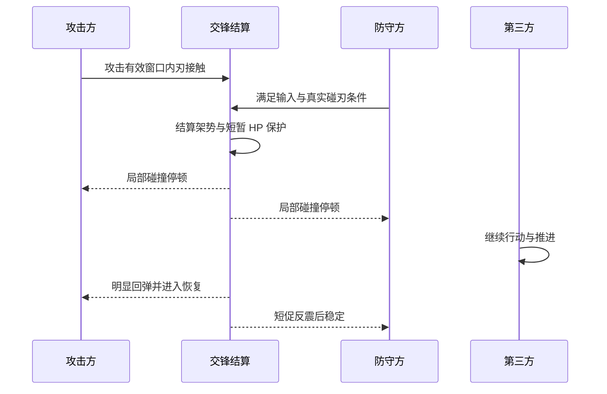
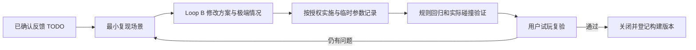

# 灰盒问题与修改验收

整理日期：2026-11-22（Asia/Shanghai）。来源为当前对话中的用户试玩反馈与后续明确选择。本文按用户要求随项目上传归档，**记录需求，不代表已经实施**。

当前代码基线仍是首轮灰盒。2026-10-18 的 28/25/25 项历史通过记录不能用于关闭下列问题；用户试玩已经暴露其覆盖缺口。

## 1. 修改清单

| ID | 优先级 | 问题／目标 | 状态 | 责任与协作 |
|---|---|---|---|---|
| GB-001 | P0 | 从背后攻击经常无法命中；修正实体阻挡与刃／柄可达性 | CONFIRMED / TODO | 客户端＋系统策划＋测试 |
| GB-002 | P0 | 基础跳跃应足以躲过贴地、低位横扫；能否越过本体取决于体型 | CONFIRMED / TODO | 客户端＋动作／数值＋测试 |
| GB-003 | P0 | 蓄力冲刺无敌残影中段能穿过其他单位 | CONFIRMED / TODO | 客户端＋系统策划＋测试 |
| GB-004 | P0 | 弹反反馈：攻击方明显回弹，防守方短促反震后稳定；双方局部碰撞停顿 | CONFIRMED / TODO | 客户端＋动作／视觉／音频＋测试 |
| MOT-001 | P1 | 持续优化刀／剑／矛的不同动作模组 | CONFIRMED / BACKLOG | 系统策划＋动作／美术＋客户端 |

## 2. 具体规则、证据与验收

### GB-001：背后攻击

| 字段 | 内容 |
|---|---|
| 用户现象 | 从背后攻击判定异常，很多时候打不到目标 |
| 已读源码事实 | `WeaponActor.Initialize` 添加玩家半径 0.95、Boss 半径 1.25 的实体支撑圆；刃／柄均是独立触发器；`GrayboxGame.HitZoneFor` 没有目标朝向过滤 |
| 几何推论 | 同高近水平时，两支撑圆相距至少 2.20；刀刃 1.15 与 Boss 柄 0.70 合计 1.85，可能被支撑圆提前挡住。这是源码推论，未测失败频率 |
| 另一差异 | 大厅练习对象不会触发出招时朝向修正／接近位移，战斗目标会；两个场景需分别复现 |
| 修改目标 | 实体阻挡不能造成可见攻击区域无法接近其应可触及的受击区域；保留刃／柄区别和同招防重复结算 |
| 待确定 | 最终实体轮廓、接触余量及具体尺寸，通过灰盒复现选定，不直接把推论当最终修复方案 |

| 用例 | 输入条件 | 预期 |
|---|---|---|
| GB-001-A | 三种武器，各自从目标前／后方、左右镜像发动攻击 | 有效窗口真实接触刃／柄时正确结算 |
| GB-001-B | 大厅练习对象与暂停决策的战斗 Boss 对照 | 不因不可见支撑体造成背后不可达；朝向规则差异显式记录 |
| GB-001-C | 接近、墙边、挥空、持续重叠 | 不借扩大伤害区导致隔空命中或反复扣血 |

### GB-002：跳跃躲避

| 字段 | 内容 |
|---|---|
| 已确认能力 | 能躲过贴地、低位横扫；能否越过本体按体型决定 |
| 躲避依据 | 跳跃使武器的受击区域实际离开攻击范围；不自动添加跳跃无敌 |
| 当前参数入口 | `PrototypeSettings.asset` 中 `JumpImpulse` 当前为 8.5；源码重力缩放 2.5、线性阻尼 1，均为灰盒值 |
| 旧测试缺口 | 只断言起跳 0.17 秒后高度增加大于 0.4，没有验证是否避开攻击 |
| 待调参数 | 跳跃高度、到顶时间、下落速度；具体值及攻击高度基准先保留 `null` |

| 用例 | 输入条件 | 预期 |
|---|---|---|
| GB-002-A | 同一低位横扫，站立与合适时机起跳对照 | 站立受击；跳跃时受击区域离开攻击范围，避免命中 |
| GB-002-B | 刀／剑／矛及其转动姿态 | 长柄、刃尖的实际位置一并考虑，不只检查根节点离地 |
| GB-002-C | 高位或空中覆盖攻击 | 仍按真实接触受击，不把跳跃变成通用无敌 |

### GB-003：蓄力冲刺穿身

| 阶段 | 已确认命中保护 | 单位穿身 |
|---|---|---|
| 普通冲刺全程 | 无该冲刺提供的保护 | 未新增穿身能力 |
| 蓄力冲刺开头 | 无该阶段保护 | 本次新增穿身只覆盖残影中段 |
| 蓄力冲刺残影中段 | 免 HP、命中架势增长、击退与打断 | 解除单位之间实体阻挡，可以穿过对方 |
| 蓄力冲刺结尾／提前退出 | 立即撤销残影保护 | 退出本次穿身状态；重叠时的稳定分离方法待实现验证 |

**实现防护建议**：保留地面／墙体碰撞；不要直接关闭同时承担落地的唯一支撑体。残影结束仍与目标重叠时，恢复受击规则与实体分离分别处理，不因分离延长无敌。墙面行为和分离算法是工程建议，不冒充用户已明确决定的细则。

验收覆盖：地面／空中、左右方向、目标靠墙、残影结束在目标内部、冲刺取消／退出和重新开房。正常穿过单位，地面与边界行为稳定；共享次数、消费与回充不回归。

### GB-004：弹反反馈

| 反馈环节 | 已确认要求 | 状态 |
|---|---|---|
| 攻击方 | 进攻受阻后明显回弹 | CONFIRMED |
| 防守方 | 短促反震，随后稳定 | CONFIRMED |
| 碰刃瞬间 | 加入短促碰撞停顿 | CONFIRMED |
| 影响范围 | 仅停顿参与本次弹反的双方，其他单位和场景继续运行 | CONFIRMED |
| 数值 | 停顿时长、回弹角度／位移、反震与稳定时间 | OPEN，尚未定稿 |
| 配套表现 | 接触特效、音色及普通／精确差异 | PROPOSED / OPEN；需继续细化，未批准具体资产方案 |

建议的表现链路：



上图为待实现的反馈顺序，不定义尚未确认的精确毫秒及各计时器重叠方式。测试必须检查：停顿不意外延长弹反 HP 保护、不消除第三方命中、普通／精确仍需真实接触、回弹不会直接覆盖已有物理驱动产生抖动。单人灰盒无法充分验证第三方继续行动，需隔离测试或后续多人场景。

### MOT-001：武器动作模组

逐武器检查起手、攻击轨迹、接触、回弹、派生连接和收招。刀／剑／矛的差异需要体现在轨迹、节奏、支点及回收，正式手绘和依图稿模组继续等待参考。当前共用动作只是占位，不视为正式动作定稿。

## 3. 临时参数结构

以下是待调参的数据合同；不是当前已存在的配置字段，也不是已批准的最终数字。

```json
{
  "status": "OPEN",
  "collision": { "playerBodyShape": null, "bossBodyShape": null, "contactMargin": null },
  "jump": { "height": null, "timeToApexSeconds": null, "fallSpeed": null, "lowSweepReferenceHeight": null },
  "chargedDash": { "passThroughPhase": "Middle", "overlapResolutionPolicy": null },
  "parryFeedback": { "localStopSeconds": null, "attackerReboundAngle": null, "defenderRecoilSeconds": null }
}
```

## 4. 状态流转与边缘测试／漏洞预判



| 极端情况 | 风险 | 防范与验收 |
|---|---|---|
| 缩小实体阻挡后多人和多段同时重叠 | 多次结算、架势无界增长 | 攻击实例／目标去重，逐对交锋与攻击方架势合并独立验证 |
| 残影结束在目标或墙边内部 | 卡住、弹飞、穿墙或遗留无敌 | 分离与保护计时分开；退出保护立即生效；墙边、空中和取消路径复验 |
| 双方停顿时第三方攻击 | 全局暂停、计时冻结导致额外无敌 | 不使用全局停时模拟双方停顿；逐个来源验证 HP 保护、恢复及物理状态 |
| 提高跳跃后只看根节点高度 | 长柄仍被扫到，或高位攻击也无故失效 | 用真实刃／柄几何做站立／跳跃对照；以攻击覆盖范围验收 |
