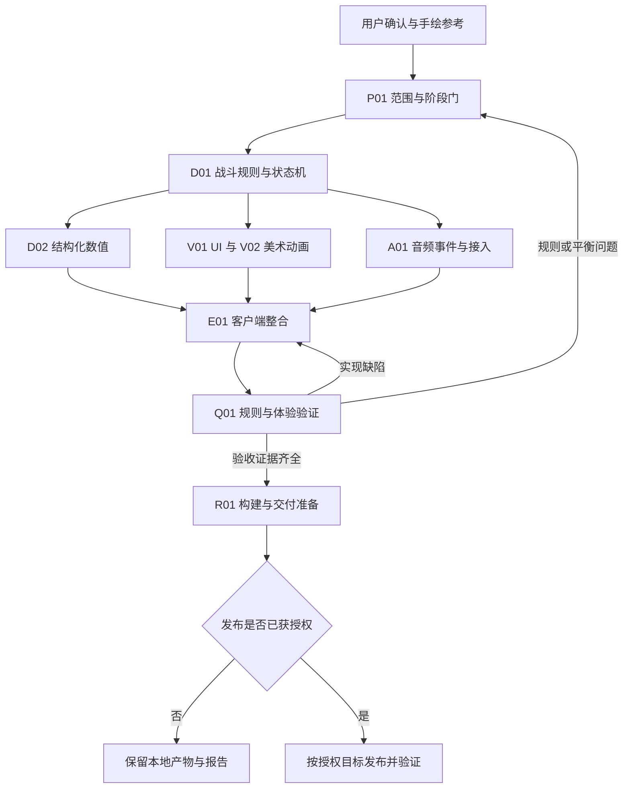

# 项目岗位编制与技能绑定

| 字段 | 当前记录 |
|---|---|
| 文档版本 | 0.2，更新当前实施阶段 |
| 归档日期 | 首次 2026-10-15；更新 2026-11-22（Asia/Shanghai） |
| 维护人 | P01 制作人 / 主策划 |
| 技术与美术路线 | Unity；2D 横板；手绘拼贴 |
| 当前验证范围 | 1 个 Boss 的战斗验证；完整连战 Boss 数量待定 |
| 当前项目阶段 | 首轮几何灰盒已运行；四项试玩修订待实施；正式手绘及依图稿模组等待参考 |
| 多人边界 | 完整目标 1–3 人本地同屏；当前只实现键盘单人，手柄／多人后续接入；在线后置 |
| 模式边界 | 高难度模式、派对模式；具体规则与数值以 GDD 为准 |

本文件是 **9 个岗位的职责、技能与交接说明**。它不代表已经启动 9 个常驻进程，也不代表自动角色加载、工程连接或岗位产出能力已经验证。执行任务时，由制作人按范围分配临时协作任务，并显式提供岗位身份、必要上下文、技能入口、允许写入的文件及验收条件。

用户已先后授权几何灰盒开发及将现有项目上传 GitHub 并附开发文档。工程现状见开发指南与测试报告；本岗位表不扩展已授权范围，正式美术仍等待手绘参考，在线服务后置。岗位分配用于具体工作交接，不代表九个常驻员工进程。

## 1. 项目协议与阶段门

玩法、范围、数值状态及用户确认记录，以 [GDD_MVP.md](GDD_MVP.md) 为准；迭代前同时读取 [Project_Memory.md](Project_Memory.md)。本文件不能覆盖 GDD，也不能用岗位分工推导未确认的玩法需求。

用户的 GDD Protocol 适用于全部岗位：机制必须可执行；逻辑与数据分离；使用结构化参数与 Mermaid；包含边缘测试及漏洞防范；限制 MVP 范围；先读后写；归档时直接落盘。

| 阶段 | 进入条件与动作 | 禁止事项 |
|---|---|---|
| Loop A：需求对齐 | 每次聚焦 1–3 个机制或表现问题，补齐核心规则 | 核心机制未闭合前提前写策划文档或开始实现 |
| Loop B：大纲审阅 | 用户确认需求闭环或要求开始策划后，在聊天中提出 GDD 大纲，包含至少 2 个极端漏洞及防范 | 把大纲审阅自动解释为完整文件归档或开发授权 |
| Loop C：完整归档 | 用户明确要求把完整文件整理到工程后，写入 GDD 及相应归档材料 | 把归档授权扩大为工具安装、工程开发或发布授权 |

阶段细节与最新批准状态见 GDD；实施任务仍以用户后续授权为准。技能中的默认工作流不得越过项目阶段门。

## 2. 分组与技能绑定

“主技能”表示岗位获得相应任务时优先查阅的技能，不表示现在必须执行。“按需技能”只在实际触发条件满足时使用。技能编号的完整入口见第 5 节。

| 组别 | 岗位编号 | 岗位 | 主规范 / 主技能 | 按需技能 | 核心职责边界 |
|---|---|---|---|---|---|
| 制作与设计组 | P01 | 制作人 / 主策划 | 用户 GDD Protocol | S01 OpenAI 文档；S02 技能安装 | 需求确认、范围、决策记录、跨岗验收；不把工具可用性当成开发授权 |
| 制作与设计组 | D01 | 系统 / Boss 战斗策划 | 用户已确认设计；S03 玩法不变量核查 | S04 平衡评估方法 | 设计战斗规则、Boss 行为及系统接口；S03 是核查辅助，不是完整 Boss 设计能力 |
| 制作与设计组 | D02 | 数值策划 | S04 平衡评估 | S05 表格；S06 Jupyter Notebook | 维护模式参数与可复现实验；不擅改规则或把暂定目标变成强制验收线 |
| 视觉与音频组 | V01 | UI 设计师 | S07 Unity UI 路由 | S08 uGUI（候选）；S09 图像生成 | 将操作、状态、模式和反馈做成可读界面；图片不能替代可交互控件和实时文字 |
| 视觉与音频组 | V02 | 场景 / 武器 / 动画设计师 | S09 图像生成 | S10 Photoshop；S11 Sprite 编辑；S12 图集管理 | 依据用户手绘图制作手绘拼贴资产、姿势与动画素材；负责素材一致性和接入规格 |
| 视觉与音频组 | A01 | 音频工程师 | S13 Mixer 路由 | S14 音频优化；S15 Unity CLI 执行入口 | 音频事件接入、已有素材导入与路由、播放及性能检查；不宣称这些技能能创作 BGM |
| 工程与质量组 | E01 | 客户端开发 | S15 Unity CLI；S16 Unity 包管理 | S03 玩法不变量；对应资产/UI 专项技能 | 实现已批准的 2D 战斗、输入、状态与表现同步；承担动画播放和战斗窗口同步 |
| 工程与质量组 | Q01 | 测试工程师 | S03 玩法不变量；S04 平衡评估 | S15 Unity CLI；S05 表格 | 验证规则、可视反馈、模式与已实现多人边界，输出可复现缺陷和回归证据 |
| 工程与质量组 | R01 | 整合发布 | S15 Unity CLI；S16 Unity 包管理 | S12 图集构建检查 | 集成、依赖一致性、构建及交付清单；不得自行修改平衡、决定发布渠道或执行未授权发布 |

### 2.1 当前不采用的路线

| 路线 / 技能 | 本项目处理 |
|---|---|
| `pixel-art-sprites`、`game-assets`、`unity:2d-pixel-perfect` | 不绑定；当前为手绘拼贴，不自动转为像素风 |
| `pixel-art-game-builder` | 不绑定；其放置/增量循环不适合作为动作战斗架构 |
| `add-audio` | 不绑定；它面向浏览器 Web Audio，不是 Unity 音频管线 |
| Sites、浏览器游戏前端路线 | 不绑定；E01 是 Unity 客户端岗位 |
| `unity:physics-3d-collision` | 不用于 2D 碰撞；Physics2D 问题按项目所用 2D API 检查 |
| 联机服务、在线语音、账号与运营后台 | 后置；不得因长期多人目标提前纳入单 Boss 验证 |

## 3. 输入、输出、验收与写入责任

下表规定责任归属，不要求现在创建所列交付物，也不预设最终代码目录。每次任务下发前，P01 必须分配具体文件，避免并行覆盖同一文件。

| 岗位 | 必要输入 | 交付输出 | 最低验收条件 | 写入责任 | 主要交接对象 |
|---|---|---|---|---|---|
| P01 | 用户决策、现有 GDD、项目记忆、各岗证据 | 审定范围、任务单、决策记录、阶段验收结论 | 已确认与待确认事项分开；当前仍限定 1 个 Boss；结论有来源 | 统筹文档、跨岗接口决策；维护本编制表 | 全岗位；重大设计决定交用户 |
| D01 | 用户核心体验、模式定义、武器设定、手绘参考 | Boss 状态机、动作阶段与交互规则、数据字段定义、漏洞清单 | Mermaid 与规则一致；触发、退出、优先级、冲突和异常路径可执行；参数不藏在长段文字中 | 战斗与系统规则规格；涉及 GDD 的更新由 P01 统合 | D02、V01、V02、A01、E01、Q01 |
| D02 | D01 规则、模式目标、已实现指标与测试记录 | 结构化数值表、参数状态、实验报告、调参建议 | 单位与公式明确；配置可追溯；量化结论带样本量、种子或复现入口；未测项目标注未验证 | 数值配置与实验材料；不改规则实现 | P01、D01、E01、Q01 |
| V01 | D01 状态与操作规则、V02 视觉规范、用户手绘参考 | UI 布局、状态展示规范、控件素材与授权范围内的 UI 资源 | 规则变化能被玩家及时看见；高难度/派对信息一致；运行文字可更新；遮挡与可读性经实机画面检查 | UI 设计与资源；涉及客户端公共逻辑由 E01 实现 | D01、V02、E01、Q01 |
| V02 | 用户手绘图、D01 动作阶段、画面与资产约束 | 场景/武器资产、关键姿势或动画帧、枢轴/透明边界/命名规格 | 风格对齐；攻击前摇、生效、后摇可区分；关键姿势、尺寸与枢轴一致；视觉不擅自改变判定范围 | 指派的美术资源、动画素材与导入规格；不改伤害或动作时序规则 | V01、E01、Q01 |
| A01 | 已批准音频需求、可用且来源明确的音源、战斗事件定义 | 事件到音源映射、导入与路由设置、试听及性能记录 | 事件播放正确；重复触发受控；静音/音量行为符合规则；设置读回验证；优化结果注明设备 | 指派的音频资产与接入配置；战斗事件代码由 E01 维护 | D01、E01、Q01、R01 |
| E01 | 审定规则、模式参数、资源规格与接口 | Unity 客户端实现、可运行验证版本、必要日志 | 单 Boss 流程与状态机一致；逻辑与配置分离；2D 判定和重复结算受控；编译与规定检查通过 | 指派的客户端代码、场景/预制体接入；包改动与 R01 协调 | D01、V01、V02、A01、Q01、R01 |
| Q01 | 需求版本、待测构建、配置版本、已确认验收线 | 测试用例、缺陷复现、回归记录、未覆盖项 | 区分已通过/失败/未执行；验证数值正确及玩家实际看到的反馈；不以模拟替代人工动作体验评价 | 测试与证据文件；不直接改产品规则或生产数值 | 缺陷交 E01；规则歧义交 D01/P01；调参证据交 D02 |
| R01 | 通过规定检查的实现、依赖清单、QA 证据、交付目标 | 集成构建、版本/配置清单、已知问题、交付记录 | 构建来源和目标可追溯；产物实际启动验证；素材/依赖齐全；有明确授权才对外发布 | 构建及集成配置、版本清单与产物记录；不独占或覆盖他岗源资产 | Q01、E01、P01；对外发布由 P01 核对授权 |

### 3.1 跨岗交接规则

交接任务至少包含下列字段；不能以“做完了”代替可检查产物。

| 字段 | 含义 |
|---|---|
| `task_id` / `owner` | 唯一任务编号与唯一责任岗 |
| `source_revision` | 所依据的 GDD/配置版本或明确决策记录 |
| `allowed_files` | 本任务允许写入的文件范围 |
| `inputs` / `outputs` | 输入来源与实际输出路径 |
| `acceptance` | 本任务的可检查完成条件 |
| `verification` | 实际执行的检查、结果与证据；未执行时说明原因 |
| `limitations` | 尚未实现、尚未验证、已知问题 |
| `next_owner` | 下一责任岗及其需要检查的内容 |

同一文件只设一个当前写入负责人。D01 定义规则、D02 管数值、E01 实现、Q01 验证；变更跨越边界时先由 P01 对齐，不另建互相矛盾的规则副本。测试通过不等于发布获批，文件存在不等于资产已接入，工具存在不等于编辑器可执行。

## 4. 能力状态与关键限制

| 项目 | 已知状态 | 使用边界 |
|---|---|---|
| 技能入口 | 第 5 节 16 个 `SKILL.md` 路径已逐项确认存在 | 只证明入口存在；真正执行时仍须阅读技能并核验依赖 |
| 新增外部技能 | `implementing-gameplay-invariants`、`eval-driven-game-development`、`jupyter-notebook` 已安装 | 安装不代表工程内已有验证器、仿真器或 Notebook |
| Unity CLI | 前期盘点已发现 CLI | Unity Editor 连接、版本、许可与命令能力尚未验证；不能宣称可直接运行项目 |
| Photoshop / Flue | 技能文件存在 | 软件及桥接连通尚未实测；不能承诺已能操作 PSD 图层 |
| 手绘参考与开发 | 等待用户手绘图；实际开发尚未开始 | 不先生成一套风格替代用户参考，不创建游戏工程 |
| UI | Unity UI 路由技能作为入口；uGUI 为候选，运行时 UI 框架尚未确定 | 实际实现前结合工程与需求选择框架；不要同时建立两套运行时 UI。图像生成只用于适合位图的视觉内容 |
| Sprite 编辑 | 技能支持切图、枢轴、边界等元数据 | 需要可运行的 Editor 与相应能力；不可手改 `.meta` 绕过导入器 |
| SpriteAtlas | 按需要用于图集与构建 | 图集不等于动画系统。默认预构建流程；先确定交付方式，不因单 Boss 验证自动引入 Addressables |
| BGM / SFX 制作 | 当前绑定技能覆盖音频工程 | 不具有已验证的 BGM 创作能力；音源制作或采购需另行明确来源与授权 |
| Mixer 操作 | 可盘点已有组并路由 AudioSource | 不以反射或手改 `.mixer` 创建组/操作结构；缺组时按技能支持的编辑器流程处理 |
| 音频技能冲突 | 优化技能包含 Mixer 树/效果操作描述，与路由技能的公开 API 限制不一致 | 只使用稳定公开 API 可支持并能读回验证的操作；音频导入优化与结构/效果调整分开，不宣称自动完成后者 |
| 平衡评估 | 可组织实验与回归 | 先确认仿真真正实现待测机制；暂定设计阈值应标为 `provisional` 且不阻断构建；不能以机器人胜率证明趣味性 |
| 玩法不变量 | 可核查重复收益、无限安全态、状态冲突等 | 不自动套用“连按必须弱”等其他游戏目标；只落实本项目已确认的设计承诺 |
| 角色运行 | 本文定义岗位与技能绑定 | 不声明 9 个常驻代理、自动加载岗位配置或长驻后台工作已经实现 |

## 5. 已核验的技能入口

以下是本次归档时实际存在的本机路径。缓存版本可能随更新变化；未来若路径失效，重新发现当前入口，不盲目依赖旧路径。本表只记录查阅位置，不改动技能或缓存。

| 编号 | 技能 | 本机入口 |
|---|---|---|
| S01 | `openai-docs` | [SKILL.md](C:/Users/Administrator/.codex/skills/.system/openai-docs/SKILL.md) |
| S02 | `skill-installer` | [SKILL.md](C:/Users/Administrator/.codex/skills/.system/skill-installer/SKILL.md) |
| S03 | `implementing-gameplay-invariants` | [SKILL.md](C:/Users/Administrator/.codex/skills/implementing-gameplay-invariants/SKILL.md) |
| S04 | `eval-driven-game-development` | [SKILL.md](C:/Users/Administrator/.codex/skills/eval-driven-game-development/SKILL.md) |
| S05 | `spreadsheets:Spreadsheets` | [SKILL.md](C:/Users/Administrator/.codex/plugins/cache/openai-primary-runtime/spreadsheets/26.1013.11914/skills/spreadsheets/SKILL.md) |
| S06 | `jupyter-notebook` | [SKILL.md](C:/Users/Administrator/.codex/skills/jupyter-notebook/SKILL.md) |
| S07 | `unity:ui` | [SKILL.md](C:/Users/Administrator/.codex/plugins/cache/openai-curated-remote/unity/0.1.6-beta/skills/ui/SKILL.md) |
| S08 | `unity:ui-ugui` | [SKILL.md](C:/Users/Administrator/.codex/plugins/cache/openai-curated-remote/unity/0.1.6-beta/skills/ui-ugui/SKILL.md) |
| S09 | `imagegen` | [SKILL.md](C:/Users/Administrator/.codex/skills/.system/imagegen/SKILL.md) |
| S10 | `Photoshop` | [SKILL.md](C:/Users/Administrator/.agents/skills/photoshop/SKILL.md) |
| S11 | `unity:sprite-editor` | [SKILL.md](C:/Users/Administrator/.codex/plugins/cache/openai-curated-remote/unity/0.1.6-beta/skills/sprite-editor/SKILL.md) |
| S12 | `unity:manage-sprite-atlas` | [SKILL.md](C:/Users/Administrator/.codex/plugins/cache/openai-curated-remote/unity/0.1.6-beta/skills/manage-sprite-atlas/SKILL.md) |
| S13 | `unity:audio-setup-mixers` | [SKILL.md](C:/Users/Administrator/.codex/plugins/cache/openai-curated-remote/unity/0.1.6-beta/skills/audio-setup-mixers/SKILL.md) |
| S14 | `unity:optimize-audio` | [SKILL.md](C:/Users/Administrator/.codex/plugins/cache/openai-curated-remote/unity/0.1.6-beta/skills/optimize-audio/SKILL.md) |
| S15 | `unity:unity-cli` | [SKILL.md](C:/Users/Administrator/.codex/plugins/cache/openai-curated-remote/unity/0.1.6-beta/skills/unity-cli/SKILL.md) |
| S16 | `unity:unity-package-management` | [SKILL.md](C:/Users/Administrator/.codex/plugins/cache/openai-curated-remote/unity/0.1.6-beta/skills/unity-package-management/SKILL.md) |

## 6. 编制的边缘检查

| 风险 | 防范与责任岗 |
|---|---|
| 技能名被当成已完成能力验证 | P01 区分入口存在、依赖可用、真实执行、结果验收四个状态；Q01/R01 核对证据 |
| 两个岗位同时改同一场景、配置或规则 | P01 为任务指定唯一写入负责人；其他岗位通过建议或缺陷交接，不并行覆盖 |
| 美术动画与实际攻击判定分离 | D01 提供阶段定义，V02 提供对应姿势，E01 同步实现，Q01 检查真实画面与判定 |
| 调参掩盖规则漏洞，或测试为了通过而放宽目标 | D01/E01 先核查规则；D02 记录数值变更原因；Q01 保留原始复现与阈值状态 |
| 从一场 Boss 验证扩展到完整连战、在线服务或后台运营 | P01 拒绝把后置项隐式纳入任务；新增范围按 GDD 阶段门重新确认 |
| 将归档、构建准备或 QA 通过误解为开发/发布授权 | 每个任务单记录授权范围；R01 在对外操作前核对明确发布授权 |
