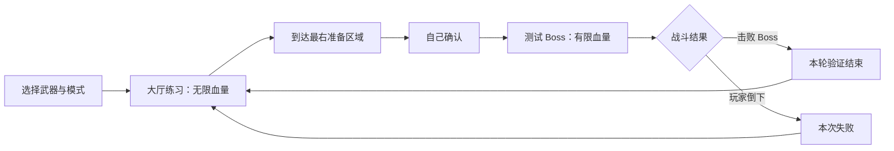

# 武器本体动作游戏｜首轮战斗灰盒

更新日期：2026-10-18。当前版本用于验证键盘操作与战斗规则，正式项目名称尚未确定。画面使用几何占位；儿童涂鸦、纸张背景、撕纸拼贴和正式动作表现将在手绘参考到位后制作。

> 2026-11-22：已附 [开发指南](../Docs/Development_Guide.md) 和 [最新问题清单](../Docs/Graybox_Issues.md)。背后攻击、跳跃躲避、残影穿身与弹反反馈均待修。GitHub 源码仓库不包含 `Builds/`，克隆后请先按开发指南构建。

**本轮范围：键盘单人，刀／剑／矛选择，大厅练习、最右侧准备区确认，以及一个测试 Boss。** 手柄、多人同屏、队友互伤的实际多人场景、倒地救援、奖励卡和技能树尚未接入。多人弹反的规则测试通过，不代表多人游戏已经可玩。

## 1. 启动与开始

历史交付状态：本机生成过 Windows 试玩包，独立程序通过 25 项场景检查。本机产物入口为 `Builds/Windows/WeaponGraybox.exe`，GitHub 克隆需要先构建。实测范围与限制见 [灰盒测试报告](../Docs/Graybox_Test_Report.md)。

| 使用方式 | 入口 | 条件 |
|---|---|---|
| Unity 编辑器 | 用 Unity `6000.6.5f1` 打开 `WeaponGraybox`，打开 `Assets/Graybox/Scenes/CombatGraybox.unity`，点击 Play | 首次打开需要导入工程资源；场景也可通过菜单 `Graybox > Create or Open Test Scene` 打开 |
| Windows 试玩包 | `Builds/Windows/WeaponGraybox.exe`，已构建成功 | 保留同目录中的运行库和 `WeaponGraybox_Data` 文件夹，不单独移动 exe |

1. 在选角界面点击刀／剑／矛，或按 `1 / 2 / 3` 选择。模式按钮可用鼠标切换。
2. 点击“进入大厅”或按 `Enter`。大厅玩家与练习对象均为无限血量，可以练习攻击与移动。
3. 移动到大厅**最右侧的准备区域**。出现确认窗口后，点击确认或按 `Enter` 进入 Boss 战。
4. 击败测试 Boss 或玩家血量耗尽后，可从结果窗口返回大厅再试一次。这是单 Boss 验证结束，不代表正式连战通关。

## 2. 操作

| 按键 | 固定称呼／用途 | 当前灰盒行为 |
|---|---|---|
| A / D | 移动 | 左右移动 |
| S | 蓄力 | 原地按住，观察“蓄力”百分比；移动、跳跃或执行其它未强化的操作会清空蓄力 |
| J | 轻攻击 | 点击发动；在衔接窗口再次点击可尝试轻攻击的派生攻击；按住不会自动连续出招 |
| K | 跳跃 | 地面起跳；W 不负责跳跃 |
| L | 冲刺 | 消耗一次共享使用机会；普通冲刺没有无敌帧 |
| S 蓄满并继续按住，再按 L | 蓄力冲刺 | 消耗本次蓄力与一次冲刺机会；仅残影中段获得保护，开头和结尾仍可受击 |
| U | 重攻击 | 发动重攻击 |
| Enter | 界面确认 | 选角后进入大厅；已抵达准备区时确认开战 |
| Esc | 重新选角 | 回到选角界面，重开本轮练习或挑战 |

普通冲刺与蓄力冲刺共用 **2 次**机会，每 **1.5 秒恢复 1 次**；1.5 秒仍是暂定值。当前试验采用串行回充。蓄力冲刺不保留旧方案中的 1.8 倍距离。

## 3. 观察战斗反馈

| 画面／状态提示 | 含义与试验重点 |
|---|---|
| 青色轮廓 | 刃的判定范围；受击时血量伤害较低 |
| 粉色轮廓 | 柄的判定范围；受击时血量伤害较高；当前测试攻击以刃造成伤害 |
| 黄色前摇预警／“霸体”计时 | 黄色前摇提前提示即将发动霸体攻击；实际进入霸体后不能被弹反，仍可扣血，免疫打断、击退和破势，架势条锁定 |
| 红色武器与“破势”计时 | 固定时间无法操作、受到额外血量伤害；后续受击不延长失控时间 |
| “架势锁定”计时 | 破势结束后已恢复操作、架势清零，但仍需等待一段时间才能再次增长和自然回落 |
| 残影与冲刺“中段”提示 | 蓄力冲刺的保护阶段，同时阻止血量伤害、命中架势增长、击退和打断 |
| “弹反／精确弹反 · 真实碰刃” | 触发依赖实际刃刃接触及有效窗口；单独按对时机、没有接触不会成功 |

弹反后的极短保护只阻止血量伤害，**不**阻止命中造成的架势增长、击退和打断。它与蓄力冲刺的残影保护是两种规则。

界面顶部提供三个测试按钮：

- **暂停 Boss／继续 Boss**：暂停或恢复 Boss 的行动决策；已经开始的攻击仍会结束。用于隔离观察玩家攻击，不是暂停整场游戏。
- **碰撞区域**：显示或隐藏刃／柄轮廓。
- **重新选角**：切换武器或模式并重新开始。

## 4. 建议的第一轮试玩

1. 在大厅分别试刀、剑、矛，观察刃／柄比例与实际攻击接触范围。当前三种武器仍共用基础动作逻辑，不代表正式武器差异已经定稿。
2. 先用普通冲刺经过攻击，再尝试原地蓄满 S 后按 L，对比有保护的残影中段与两端。
3. 进入 Boss 战，观察前摇，预判按 J 或 U 并让双方的刃实际相撞；记录“看起来应当碰刃但没有成功”的位置和动作。
4. 比较击中刃与柄的反馈，观察架势条、破势及破势后的锁定阶段。
5. 切换高难度和派对模式。当前只改变玩家血量，Boss 血量相同；这不是两种模式的最终平衡。

反馈时请同时记录：武器、模式、操作顺序、双方位置、发生阶段、预期结果与实际结果。短视频比“感觉不对”更容易定位窗口和碰撞问题。

## 5. 参数与已知边界

运行配置位于 `Assets/Graybox/Settings/PrototypeSettings.asset`，类型定义为 `GrayboxSettings` 和 `CombatConfig`。除已确认的共享 2 次冲刺以及暂定的 1.5 秒回充外，当前血量、伤害、窗口、速度、碰撞尺寸均为 `PROTOTYPE_ONLY`，详见测试报告。正式设计的未知值仍保持待定。

- 武器的支撑碰撞体、矩形刃柄与转动轨迹用于几何测试，尚未根据手绘图重新制作。
- 当前只有基础轻攻击、重攻击和轻攻击派生样例；完整连招表、各武器专属动作、柄端攻击尚未完成。
- 尚无正式音效、音乐、手绘动画、完整技能树、存档、奖励或完整 Boss 连战。
- 单人灰盒不会验证三名玩家的设备归属、互伤体验、救援或多人确认；这些仍是后续明确任务。
- 中文界面使用本机已安装字体；其它 Windows 环境的字体兼容性需要单独验收。

完整设计基线见 [GDD_MVP.md](../Docs/GDD_MVP.md)，历史完成状态与测试证据见 [Graybox_Test_Report.md](../Docs/Graybox_Test_Report.md)，最新待修需求见 [Graybox_Issues.md](../Docs/Graybox_Issues.md)。
